# BUSINESS WORKFLOWS — Digital Equb Management System

> **Status:** Phase 1 deliverable (target behavior; not yet implemented).
> **Scope:** Critical workflows **A–I**, with alternates, ledger effects, authorization, and test obligations.
> **Companion documents:** `REQUIREMENTS.md`, `SYSTEM_ARCHITECTURE.md`, `DATABASE_DESIGN.md`, `DATABASE_ERD.md`.

---

## 0. Workflow index

| ID    | Workflow                                                      | Primary actors                           | Financial?             |
| ----- | ------------------------------------------------------------- | ---------------------------------------- | ---------------------- |
| **A** | Authentication and account administration                     | All users, Super Admin, Admin            | No (security-critical) |
| **B** | Member registration and identity verification                 | Organizer, Admin, Member                 | No (KYC)               |
| **C** | Equb group setup, rules, and activation                       | Organizer, Admin, Super Admin            | Rule-defining          |
| **D** | Membership enrollment and agreement acceptance                | Member, Organizer, Admin                 | No                     |
| **E** | Initial deposit rounds and verification                       | Treasurer, Organizer, Admin, Member      | **Yes**                |
| **F** | Contribution periods and payment verification                 | Treasurer, Organizer, Admin, Member      | **Yes**                |
| **G** | Automatic member status classification                        | System (computed)                        | Derived                |
| **H** | Payout scheduling, approval, and disbursement                 | Organizer, Treasurer, Admin, Super Admin | **Yes**                |
| **I** | Penalties, withdrawal/refund, cycle closure, audit, reporting | Treasurer, Admin, Auditor, Member        | **Yes**                |

**Cross-cutting rules** (apply to every workflow):

- Only verified payments count financially.
- No approval equals disbursement.
- No financial record is hard-deleted.
- Every state change is authorized server-side and audited.
- Unconfirmed policy (`undecided`) blocks the dependent action instead of guessing.
- All money math uses `Money` (integer santim); all monetary mutations run in transactions.

---

## 1. Workflow A — Authentication and account administration

### A.1 Actors and permissions

| Action                        | Permission                         | Notes                                 |
| ----------------------------- | ---------------------------------- | ------------------------------------- |
| Log in / log out              | —                                  | Fortify; public registration disabled |
| Reset password                | —                                  | Email token; generic response         |
| Enable/disable 2FA            | own account                        | Required for privileged roles         |
| Manage passkeys               | own account                        | Fortify passkey support               |
| Create user                   | `users.create`                     | Admin/super-admin only                |
| Edit user                     | `users.update`                     | Audited; role changes separated       |
| Assign roles                  | `users.assign_roles`               | Super Admin only by default           |
| Deactivate/unlock             | `users.deactivate`, `users.unlock` | Sessions invalidated                  |
| Reset another user's password | `users.reset_password`             | Forces change on next login           |
| View security events          | `audit.view_security`              | Auditor read-only                     |

### A.2 Login flow

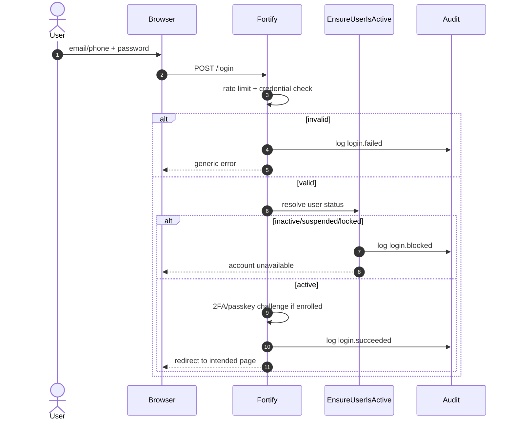

**Rules**

- Registration is disabled; users are created by an authorized administrator or a time-limited invitation.
- A deactivated user cannot log in, and existing sessions are invalidated.
- Repeated failures trigger configurable lockout; unlock requires permission or timeout.
- Login identifier decision (email vs phone, D-10) is configurable without schema changes.
- Password policy and MFA requirements come from settings, not hardcoded.

### A.3 User provisioning (admin)

1. Authorized user opens **Administration → Users → Create**.
2. Enters name, email/phone, initial roles, and activation state.
3. Server validates uniqueness and permission to assign each role.
4. Creates user with `must_change_password = true` if a temporary password is used.
5. Sends invitation/reset link (queued) if email is available.
6. Writes audit record `user.created` with role diff.

**Alternates**

- Duplicate email/phone → 422 with a clear message; no partial user.
- Role escalation attempt → 403; audit `user.role_assignment_denied`.
- Deactivating self → blocked (prevents lockout).
- Deactivating the last super-admin → blocked.

### A.4 Deactivation vs deletion

- `users.status = inactive`, `deactivated_at` set, sessions revoked.
- Financial history remains linked to the user id.
- **No hard delete.** The starter's self-service deletion is removed and replaced with an administrator-driven deactivation/anonymization flow.
- Anonymization (D-19) replaces PII but preserves ids and financial references.

### A.5 Audit and tests

Audit: login success/failure, lockout, password change, MFA change, passkey change, role change, deactivation, password reset by admin.

Tests: valid/invalid login, inactive login blocked, lockout, 2FA challenge, passkey login, self-deactivation blocked, last super-admin protected, role escalation denied, session invalidation on deactivation.

---

## 2. Workflow B — Member registration and identity verification

### B.1 Actors

Organizer/Admin registers; member may self-submit later if the portal is enabled. Treasurer does not register members by default.

### B.2 Flow

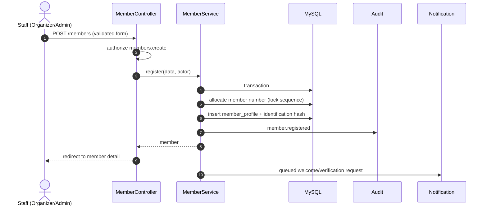

### B.3 Rules

- Member number is generated atomically and is immutable.
- Phone is required and normalized; duplicate phone requires an explicit override permission and reason.
- National ID is encrypted; only a hash and last 4 digits are queryable.
- Status starts `pending_verification` unless an authorized verifier approves immediately (not recommended).
- Identity verification is an append-only decision with reviewer, timestamp, and evidence.
- A member can exist **without** a user account; staff manage them. Linking a portal account is optional and requires unique contact data.
- Duplicate detection warns on normalized phone or ID hash; overriding requires `members.override_duplicate` and an audit reason.

### B.4 Verification decision

1. Reviewer opens pending member.
2. Checks documents and identity.
3. Approves → `member_verifications` row, member `status = active`, `verified_at/by`.
4. Rejects → reason required; member remains `pending_verification` (or `inactive` after repeated failure).
5. Notification queued; audit `member.verified` or `member.verification_rejected`.

### B.5 Member detail view

- Profile, status, KYC state (permissioned).
- Groups and membership status.
- Contribution/deposit history (read-only, verified vs pending).
- Payout history and receipts.
- Penalties, extensions, complaints.
- Timeline of events.

### B.6 Tests

Unique member number under concurrency; duplicate phone/ID detection; encrypted ID not leaked in logs/props; unverified identity cannot be activated into a group if rules require verification; auditor read-only; member sees only own record.

---

## 3. Workflow C — Equb group setup, rules, and activation

### C.1 Flow

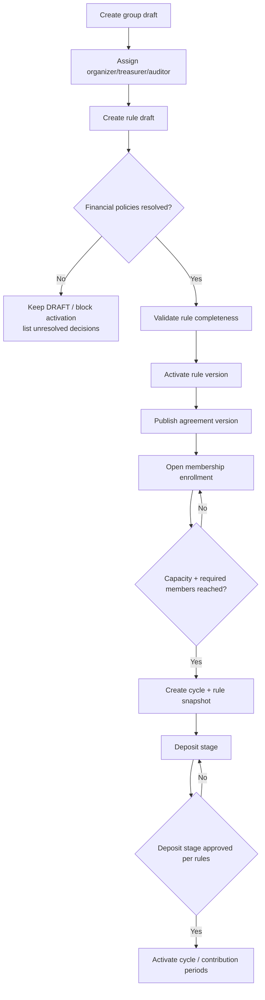

### C.2 Group creation

1. Authorized user creates a group: name, unique group number, description, capacity (ETB implied).
2. Status `draft`; no financial activity is possible.
3. Creator is recorded; group staff assignments are separate permissions.
4. Astaff member may not hold conflicting roles in the same group (e.g., treasurer + auditor) unless rules explicitly allow (D-13).

### C.3 Rule configuration

Rules are **versioned** and validated as a complete set:

| Rule                   | Validation                                               |
| ---------------------- | -------------------------------------------------------- |
| Contribution amount    | > 0, 2 dp                                                |
| Frequency              | supported enum; custom interval > 0                      |
| Due offset + grace     | non-negative; period date order valid                    |
| Capacity               | > 0 and ≤ group capacity                                 |
| Deposit rounds         | 0..n; each round amount > 0; dates ordered               |
| Payout mode            | one of configured modes                                  |
| Payout commencement    | mode + date/condition; `undecided` allowed in draft only |
| Payout formula         | explicit; `undecided` blocks activation                  |
| Deposit treatment      | explicit; `undecided` blocks activation                  |
| Partial contributions  | boolean                                                  |
| Overpayment policy     | explicit or safe default `reject`                        |
| Penalty policy         | explicit; `none` allowed                                 |
| Withdrawal policy      | explicit; `no_refund` allowed                            |
| Maker-checker          | boolean per payment/payout                               |
| Multi-group membership | boolean                                                  |

1. Saving edits on an **active** rule creates a new draft version; the active row is immutable.
2. Activating a version retires the previous active version and sets `active_flag = 1` on the new one inside a transaction.
3. A cycle snapshots the effective rules into `equb_cycles.rule_snapshot`.
4. Rule changes apply to **future** cycles/periods only; existing obligations keep their snapshots.

### C.4 Activation gates

Group activation requires:

- complete rule version (no blocking `undecided` policies);
- published, accepted agreement version;
- at least the configured minimum active memberships;
- capacity not exceeded;
- organizer and treasurer assigned (and distinct users when maker-checker/separation requires it);
- no open financial inconsistency (not applicable for first cycle).

If any gate fails: activation returns 422 listing every unmet condition. The system never activates with an invented default.

### C.5 Ledger and accounting setup

On group activation (or first cycle), seed the group chart of accounts in `financial_accounts` using the configured mapping. Accounts are created once and reused; `is_system` accounts cannot be deleted.

### C.6 Tests

Rule version immutability; single active version; activation blocked by `undecided`; snapshot correctness; capacity enforcement; conflicting role rejection; auditor cannot configure; changing active rules does not alter existing obligations.

---

## 4. Workflow D — Membership enrollment and agreement acceptance

### D.1 Paths

| Path                      | Actor           | Notes                                                 |
| ------------------------- | --------------- | ----------------------------------------------------- |
| Staff add existing member | Organizer/Admin | Immediate or pending approval per policy              |
| Member requests to join   | Member          | One open request per group                            |
| Invitation                | Organizer/Admin | Time-limited; acceptance activates or creates request |
| Waitlist                  | System          | When capacity full; ordered promotion                 |

### D.2 Flow (request → approval → activation)

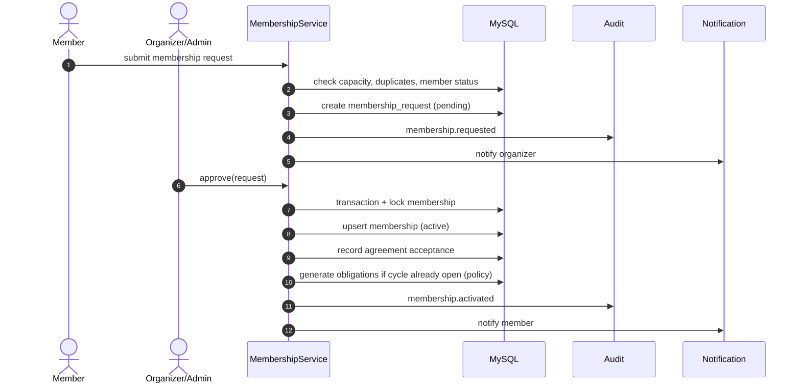

### D.3 Rules

- Capacity is checked at request **and** at approval under a lock; a race cannot exceed capacity.
- One membership per member per group; unique key plus service validation.
- Agreement acceptance is required before activation unless the member was grandfathered by policy.
- Agreement acceptance stores version, timestamp, IP/user-agent, and optional evidence.
- Start date cannot precede group cycle start; joining mid-cycle is policy-controlled and affects which obligations are generated.
- Multiple group membership follows `allow_multiple_group_membership` (D-04).
- Suspended/withdrawn members do not receive new obligations; existing unpaid obligations remain visible and are handled per policy.

### D.4 Obligation generation on join

- If the cycle is in deposit stage: generate outstanding deposit obligations per round according to policy (full round or pro-rata — must be configured; default is full upcoming round, not retroactive past rounds).
- If the cycle is active: generate the current and future contribution obligations; past periods are handled by an explicit catch-up policy.
- **Never silently invent** catch-up or pro-rata rules; `undecided` blocks mid-cycle joining.

### D.5 Suspension, withdrawal, removal

| Action   | Effect                                                        | Payout eligibility     |
| -------- | ------------------------------------------------------------- | ---------------------- |
| Suspend  | No new obligations; existing remain; access limited           | Blocked until resolved |
| Withdraw | Request + approval + refund per rules; membership `withdrawn` | Blocked                |
| Remove   | Authorized procedure with reason; financial history retained  | Blocked                |
| Complete | Cycle ended with obligations satisfied                        | N/A                    |

Every exit writes an audit record and queues a notification. No exit deletes obligations, payments, or ledger rows.

### D.6 Tests

Capacity race; duplicate membership; agreement version recorded; suspended member excluded from new obligations; auditor cannot approve membership; withdrawal blocked without policy; obligations generated exactly once.

---

## 5. Workflow E — Initial deposit rounds and verification

### E.1 Concepts

- A cycle may have **0..n** deposit rounds, configured in rules. **Do not assume three.** (`BR-DEP-01`)
- Each round has an amount per member and open/due/close dates.
- Deposit obligations are per membership per round.
- Deposits are financially and accountingly **separate** from regular contributions and from payout funds. (`BR-DEP-04`, `BR-FIN-01`)
- Deposits are **accumulated and retained**, not consumed by the rounds. (`BR-DEP-03`)
- Every **active** member must satisfy the deposit obligations for the stage. (`BR-DEP-02`)
- The stage must be **fully completed before normal payout operations begin**. (`BR-DEP-05`)
- The treatment of deposit funds (refundability, ownership, use for expenses/penalties, withdrawal) is `PENDING` (`PD-01`–`PD-04`); the system will not distribute, refund, or spend them.
- Confirmed detail: `BUSINESS_RULES.md` §3.1.

### E.2 Round setup and obligation generation

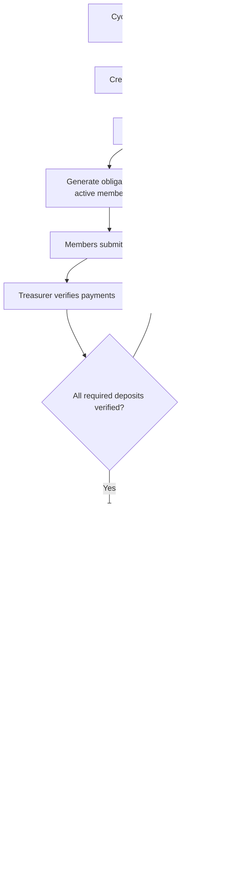

**Generation rules**

- Runs inside a transaction with the round row locked.
- `deposit_obligations` unique key makes generation idempotent.
- Members who join after generation are handled by an explicit policy; default: only the current open round, never closed rounds.
- Amount is snapshotted from the round; later rule edits do not change it.

### E.3 Payment submission and verification

Deposits flow through the same payment pipeline as contributions:

1. Member or treasurer records a deposit: amount, method, reference, paid date, evidence, target obligation.
2. Payment starts `submitted`.
3. Authorized verifier reviews evidence.
4. Verify → payment `verified`, `payment_verifications` row, allocations created, ledger posted, receipt issued.
5. Reject → payment `rejected`, reason recorded, no ledger posting, member notified.

**Maker-checker:** when enabled, the verifier cannot be the person who submitted/recorded the payment.

### E.4 Ledger effect (illustrative, mapping policy-dependent)

| Event                          | Debit             | Credit                      |
| ------------------------------ | ----------------- | --------------------------- |
| Verified cash deposit received | 1000 Cash on Hand | 2010 Members' Deposits Held |
| Verified bank deposit          | 1010 Bank Account | 2010 Members' Deposits Held |

The exact accounts and the later treatment of deposit funds follow the configured mapping (D-01), never hardcoded assumptions.

### E.5 Closing a round and the stage

- A round closes only when authorized; unpaid obligations remain visible and overdue-flagged.
- Closing does not cancel unpaid obligations.
- The next round opens only if the rule requires previous close (default true) and the actor has permission.
- Stage completion is an explicit approval (`DepositStageApproved`) and requires:
    - all configured rounds closed;
    - every active member's required deposit obligations satisfied by **verified** payments (`BR-DEP-02`, `BR-DEP-06`);
    - no blocking inconsistencies (e.g., unverified claims presented as verified);
    - payout commencement policy resolved.
- Stage completion sets the cycle gate that unlocks lottery and payout operations (`BR-DEP-05`, `BR-17`). Any attempt to draw or pay before this gate is rejected by the service, not merely hidden in the UI.
- Unpaid members may still proceed only if a confirmed group policy allows partial deposit completion; this is **not** assumed and remains `PENDING`.
- The accumulated deposit balance remains a separate, retained fund after the stage closes; it is never transferred into the payout fund. (`BR-DEP-03`, `BR-FIN-01`)

### E.6 Reports and UI

- Round view: expected total, verified total, pending, rejected, outstanding, overdue count.
- Member view: per-round obligation, verified amount, balance, status, evidence.
- Stage view: per-member completion, blocking members, approval state.
- Distinguish deposits from contributions and payout funds in every report and ledger view.
- Deposit treatment (refund/ownership/use) is displayed as "pending policy" where relevant; the UI must not imply a refund or distribution.

### E.7 Tests

Configurable round count (0, 1, 3, 5); unique obligations; unpaid deposit not counted; duplicate deposit reference rejected; verifier ≠ submitter; stage approval blocked with unresolved deposit policy; deposit and contribution balances remain separate; deposit stage gate blocks lottery/payout; retained deposit balance does not change when payouts are disbursed.

---

## 6. Workflow F — Contribution periods and payment verification

### F.1 Period generation

1. On cycle activation, generate contribution periods from the rule snapshot (frequency, count, due offsets).
2. Persist `opens_on`, `due_on`, `closes_on`, `amount_due_snapshot`, `grace_days_snapshot`.
3. Generation is idempotent; unique `(cycle, sequence)`.
4. Period count is derived from the rotation (one payout position per period, by default), or configured explicitly.

### F.2 Obligation generation

- Generated for **every active membership in every regular round** (`BR-CON-02`).
- Generated when a period opens (or cycle activation for the first period).
- One obligation per active membership per period.
- Amount snapshot; later rule changes do not affect it.
- Joining mid-period follows the configured policy; `undecided` blocks mid-period joining.
- A member who already received a payout remains obligated for future periods (`BR-CON-04`).

### F.3 Payment lifecycle

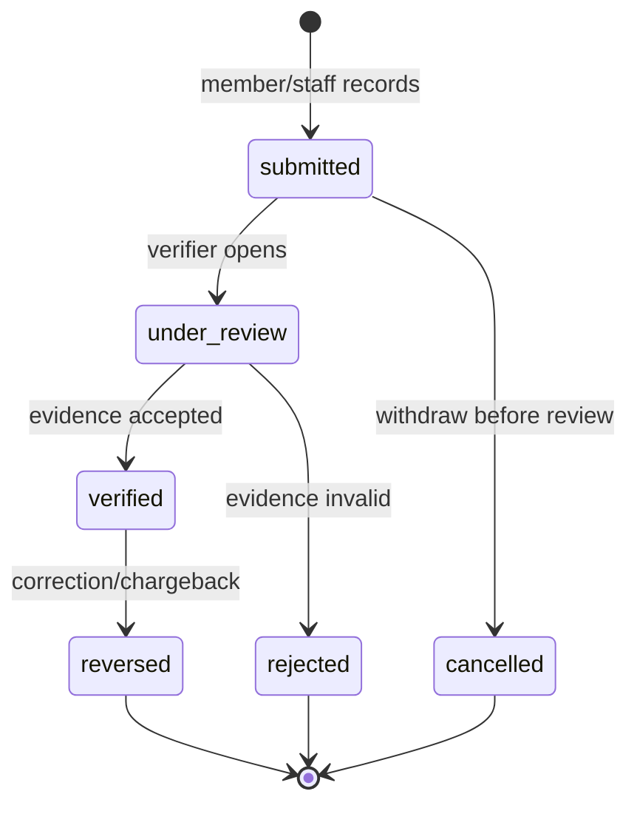

**Rules**

- Only `verified` counts.
- Verification is append-only: one terminal verification per payment record.
- Corrections create a reversal payment plus a ledger reversal; the original rows remain.
- Partial payments are allowed only when `partial_contributions_allowed = true`; allocations may split across obligations.
- Overpayment follows `overpayment_policy` (reject / credit next / refund).
- A payment reference cannot be reused within the same group/method when present.

### F.4 Verification flow

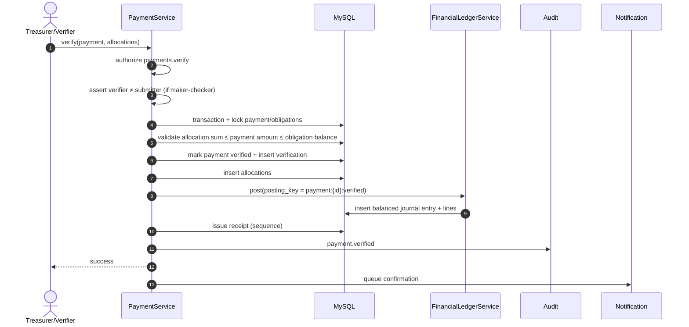

If any step fails, the transaction rolls back: no payment marked verified, no ledger entry, no receipt.

### F.5 Receipts

- Generated on verification with a unique number and an immutable snapshot.
- Contains member, group, period/round, amount, method, reference, date, verifier, organization identity.
- PDF generated asynchronously; a download link is permissioned and time-limited.
- Voiding requires authorization and an adjusting ledger entry; the receipt row remains.

### F.6 Overdue and reminders

- Overdue is derived: balance > 0 and today > due_on + grace.
- Scheduled job queues reminders before/after due date, deduplicated per period/member/channel.
- Overdue does **not** change member color by itself; it is a secondary flag.

### F.7 Tests

Unverified payment excluded from totals; partial payment sums correctly; duplicate reference/idempotency; verifier cannot self-verify; ledger balanced; receipt unique and immutable; reversal restores balances; overpayment policy honored; period lock blocks new obligations.

---

## 7. Workflow G — Automatic member status classification

### G.1 Definitions (authoritative)

Confirmed 2026-11-13. Authoritative text: `BUSINESS_RULES.md` §3.5 (`BR-STAT-01`–`BR-STAT-07`). The primary status is evaluated in the order below; `BLUE` always wins.

| Status            | Condition (evaluated in order)                                                                                        |
| ----------------- | --------------------------------------------------------------------------------------------------------------------- |
| **BLUE**          | The member has received a payout in the **current cycle** — the payout is `disbursed` or `completed`.                 |
| **GREEN**         | No payout received this cycle, and the **current required contribution** is fully covered by **verified** payments.   |
| **RED**           | No payout received this cycle, and the current contribution is unpaid or **not fully verified** (partial or pending). |
| **NEUTRAL / N/A** | Deposit stage, no open period, suspended/withdrawn membership, or no obligation generated.                            |

**Overdue is separate:** `balance > 0 AND today > due_on + grace_days`. A BLUE member can be overdue; overdue is shown as a secondary warning and never overrides the primary color. (`BR-STAT-05`)

### G.2 Priority

```
if payout_completed_in_cycle       -> BLUE
else if no_current_period          -> NEUTRAL
else if obligation_verified_total >= amount_due -> GREEN
else                               -> RED
```

`approved` or `disbursement_pending` does **not** produce BLUE.

### G.3 Computation

- `MemberStatusService::forMembership(membership, cycle, period?)` returns a DTO:
    - `status` (`CONTRIBUTION_CLEARED`, `CONTRIBUTION_OUTSTANDING`, `PAYOUT_RECEIVED`, `NOT_APPLICABLE`);
    - `color` (`green|red|blue|neutral`) — presentation mapping only;
    - `isOverdue`;
    - current period/obligation amounts and balance;
    - payout status/completion date;
    - human-readable reason.
- `countsForGroup(group, cycle)` uses aggregate queries; no per-member loop.
- The database never stores the color. No admin can set it.

### G.4 Trigger points

Recompute on read after:

- payment verified or rejected;
- payment reversed;
- period opened/closed/locked;
- payout disbursed/completed/reversed;
- membership suspended/withdrawn/reactivated;
- cycle activated/closed.

### G.5 UI presentation

- Always label + icon + color: “Paid” (GREEN), “Unpaid” (RED), “Payout received” (BLUE), “Not applicable”.
- Overdue appears as an amber secondary badge (“Overdue 5 days”) alongside the primary color.
- Legend and filters on the group dashboard.
- Tooltip/reason explains the classification.
- Color is never the only signal (WCAG).

### G.6 Tests

- Verified full payment → GREEN.
- Pending payment covering amount → RED (not GREEN).
- Partial verified payment → RED.
- Payout approved but not disbursed → unchanged.
- Payout disbursed → BLUE.
- BLUE + unpaid previous obligation → BLUE with `isOverdue = true`.
- Reversal of payout → status recomputes to GREEN/RED.
- Deposit stage → NEUTRAL.
- Suspended membership → NEUTRAL.
- 500-member aggregate query performance.

---

## 8. Workflow H — Payout scheduling, approval, and disbursement

### H.1 Preconditions

- Cycle is active and the **initial deposit stage is complete** (`BR-DEP-05`).
- Payout commencement conditions are satisfied and **explicitly configured** (D-02).
- Payout formula is resolved (not `undecided`).
- Contribution period for the payout round exists and the lottery can evaluate current contributions.
- Maker-checker actors are distinct where required.

### H.2 Lottery draw per payout round

Confirmed 2026-11-13. Authoritative text: `BUSINESS_RULES.md` §3.3 (`BR-LOT-01`–`BR-LOT-09`). A lottery draw is a **separate, auditable step before** a payout schedule item is created.

1. A payout round is opened. An authorized actor (`lotteries.draw`) starts the draw.
2. The service snapshots the **participant set**: active memberships in the cycle with no payout yet.
3. Exclusions are applied and recorded with a reason:
    - previous winner in this cycle (`BR-LOT-03`);
    - overdue contribution (`BR-LOT-04`);
    - current required contribution not fully verified (`BR-LOT-05`);
    - suspended/withdrawn/inactive membership.
4. The winner is selected **server-side** using a CSPRNG (`BR-LOT-09`, `PD-05`). Selection evidence (method, seed/hash, timestamp) is persisted.
5. The draw record stores cycle, payout round, participants, exclusions, winner, draw date/time, actor, and audit information (`BR-LOT-06`).
6. The draw is **locked** and cannot be silently edited or replaced (`BR-LOT-07`). A correction is a new audited draw with a mandatory reason; if the original winner was already paid, payout reversal is a separate approved workflow.
7. The winner becomes the candidate for that payout round. A payout schedule item/payout case is created only from a locked draw.
8. Eligibility is re-checked at payout request and again at disbursement (`BR-LOT-08`, `BR-PAY-01`).

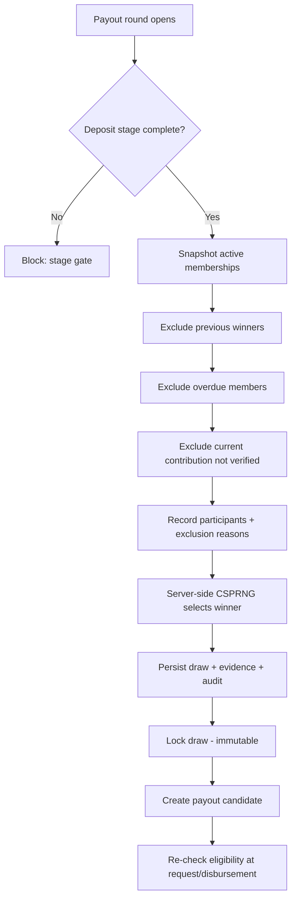

### H.3 Scheduling the payout

1. Authorized organizer/admin creates the payout schedule for the cycle from locked draws.
2. Recipient assignment follows the configured `payout_mode`; the exact lottery method and witnessing procedure remain pending (`PD-05`).
3. Each membership appears at most once per cycle (confirmed: exactly one payout per completed cycle).
4. Eligibility is validated at scheduling and again at payout time: active membership, not already paid, not suspended, no overdue, current contribution verified.
5. The schedule is activated and locked; rescheduling requires approval, retains the original item, and is audited. A reschedule never edits an existing draw.

### H.4 Payout lifecycle

A payout case is created only from a **locked lottery draw**. Approval records a decision; disbursement records actual money movement. They are never the same action (`BR-PAY-02`, `BR-PAY-03`).

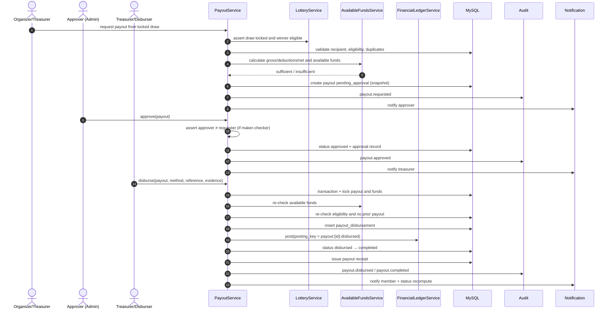

### H.5 Amount calculation

- `gross_amount` from the configured `payout_formula` and cycle snapshot.
- `deductions_amount` only from explicitly configured deductions (penalties, fees, outstanding) — never assumed.
- `net_amount = gross - deductions`; must be `>= 0`.
- `calculation_snapshot` stores inputs and formula for audit/reproduction.
- Available funds are checked under lock; a payout cannot exceed eligible funds.
- Payout before full collection is allowed only if configured (D-17).

### H.6 Approval and disbursement separation

| Step     | Permission         | Separation rule                         |
| -------- | ------------------ | --------------------------------------- |
| Request  | `payouts.request`  | Requester recorded                      |
| Approve  | `payouts.approve`  | Approver ≠ requester by default         |
| Disburse | `payouts.disburse` | Disburser ≠ approver when configured    |
| Reverse  | `payouts.reverse`  | Reason required; ledger reversal; audit |

- Approval alone leaves the payout `approved`; member is **not** BLUE.
- Disbursement records actual money movement (method, reference, date, evidence, actor).
- Completion happens only after disbursement; then a receipt is issued and status recomputes.
- A failed/reversed disbursement posts a reversing entry and returns the payout to a reviewable state; the original rows remain.

### H.7 Duplicate prevention

- Unique `payout_schedule_items(schedule, membership)`.
- Unique `payouts.payout_schedule_item_id`.
- One active (non-reversal) disbursement per payout.
- Service re-checks inside the transaction; database constraints are the final defense.

### H.8 Notifications

- Payout scheduled → member sees position/date (limited view).
- Payout requested → approver.
- Approved → treasurer.
- Disbursed/completed → member with receipt.
- Reversed/failed → member + stakeholders.

### H.9 Tests

Approval without disbursement does not set BLUE; disbursement above available funds blocked; requester cannot approve when maker-checker on; duplicate schedule item rejected; duplicate payout by concurrency blocked; reversal restores funds and status; payout receipt immutable; member sees only own position.

---

## 9. Workflow I — Penalties, withdrawal/refund, cycle closure, audit, reporting

### I.1 Penalty assessment

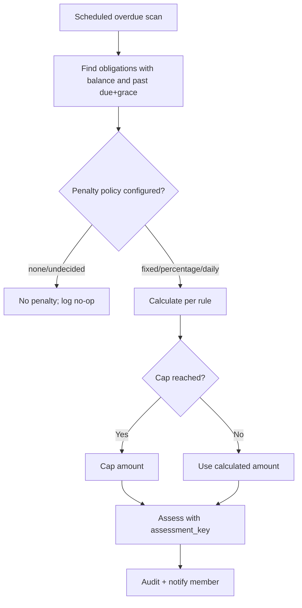

**Rules**

- Assessment is idempotent via `assessment_key`; reruns cannot duplicate.
- Calculation is deterministic and snapshotted (inputs, days, rate, cap).
- Penalties are not automatically deducted from payouts unless configured (D-18).
- Waivers require permission, reason, and approval; requester ≠ approver when maker-checker is on.
- Waivers post an adjusting ledger entry; they never delete the penalty.
- Penalties are not confiscation: unpaid penalties remain visible and follow the policy.

### I.2 Payment extensions

1. Member or staff requests an extension with a new date and reason.
2. Authorized reviewer approves/rejects.
3. Approval records the effective date and audits the change.
4. Penalty/overdue calculations use the effective due date; the original obligation snapshot remains for history.

### I.3 Withdrawal and refund

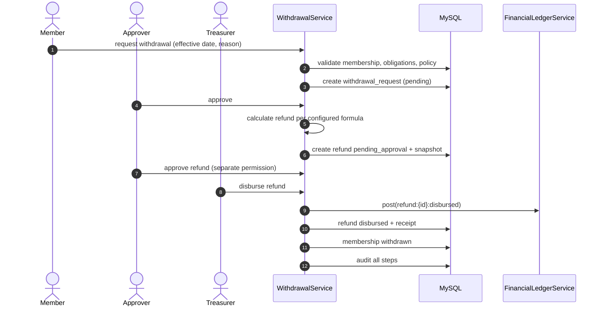

**Rules**

- Refund formula follows `withdrawal_policy` (D-08). `undecided` blocks processing.
- Outstanding obligations and penalties are handled explicitly by the formula, not silently.
- Refund approval and disbursement are separate permissions.
- No refund exceeds verified contributions/deposits eligible under policy.
- Financial history is retained; membership status changes, rows do not disappear.

### I.4 Cycle closure

1. Authorized user starts closure (`closing`).
2. System verifies:
    - all periods closed/locked;
    - no unverified payments counted as verified;
    - all payouts completed or explicitly cancelled;
    - penalties/refunds resolved or documented;
    - ledger balanced and reconciliation approved;
    - no unresolved duplicate/overpayment exceptions.
3. Close → cycle `closed`, group `completed` (or next cycle created per policy).
4. Generate final reports and archive evidence.
5. Closure is audited and cannot be silently reopened; reopening requires an explicit, audited authorization.

### I.5 Reconciliation and audit

- Reconciliation compares ledger/account/system balances to actual cash/bank/mobile balances.
- Differences must be explained line by line; unresolved differences block closure.
- Audit records every financial transition with actor, before/after, reason, and transaction reference.
- Auditors get read-only access to ledger, reports, and audit logs; no mutation endpoints.
- Sensitive exports require permission, password confirmation, and are audited with filters.

### I.6 Reporting

Every report declares:

- scope (organization/group/cycle/period);
- date basis (paid date, verified date, due date, disbursement date);
- timezone (`Africa/Addis_Ababa` display, UTC storage);
- filters and totals;
- generator and timestamp;
- permission check and audit record.

Report set: dashboard KPIs, member status, contributions, deposits, payouts, unpaid/aging, penalties, refunds, ledger/trial balance, reconciliation, audit.

### I.7 Tests

Penalty idempotency; waiver approval separation; extension affects overdue not snapshot; refund formula blocked when undecided; refund cannot exceed eligible amount; closure blocked by unbalanced ledger; closure blocked by unresolved payout; auditor cannot mutate; export audited; reports reconcile to ledger.

---

## 10. Cross-workflow state machines

### 10.1 Group

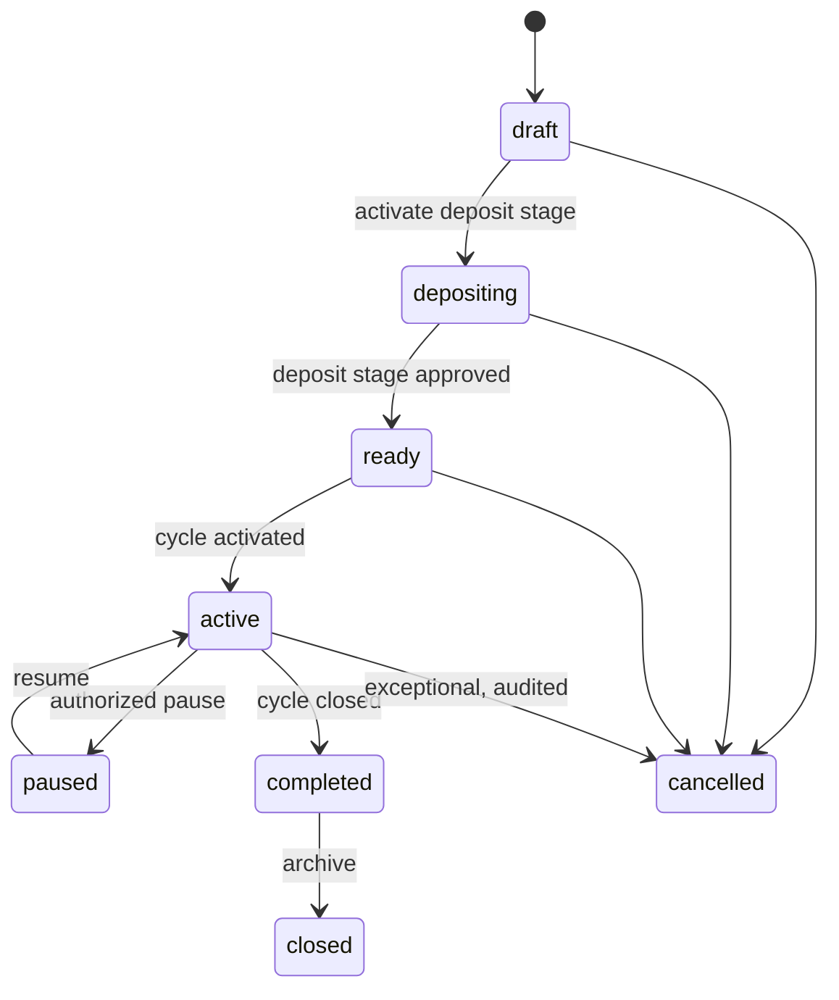

### 10.2 Membership

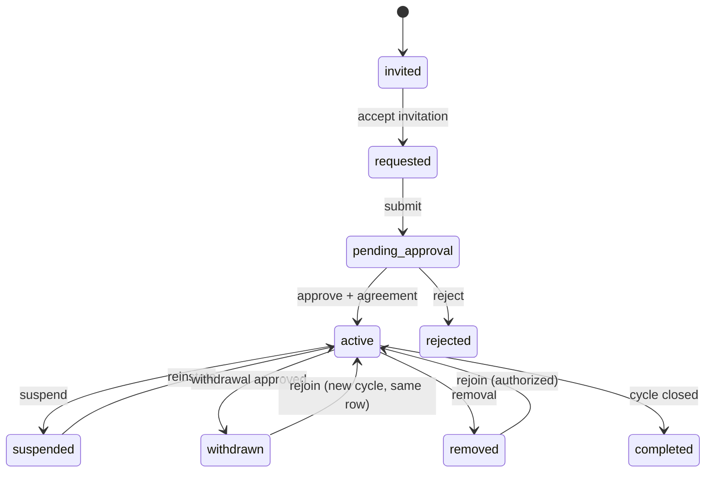

### 10.3 Payment

See §6.3. Key invariant: only `verified` affects balances/status; `rejected`/`cancelled`/`reversed` do not.

### 10.4 Rules

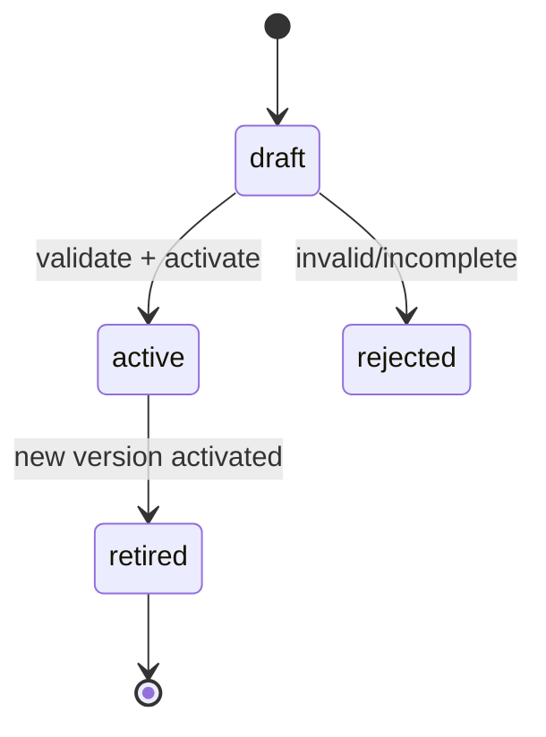

---

## 11. Authorization matrix per workflow action

| Action                      | Super | Admin             | Organizer           | Treasurer   | Auditor   | Member           |
| --------------------------- | ----- | ----------------- | ------------------- | ----------- | --------- | ---------------- |
| Create/edit member          | ✓     | ✓                 | ✓ (assigned groups) | —           | —         | own profile only |
| Verify member KYC           | ✓     | ✓                 | ✓                   | —           | —         | —                |
| Create/edit group           | ✓     | ✓                 | ✓                   | —           | —         | —                |
| Configure/activate rules    | ✓     | approve           | ✓                   | —           | —         | —                |
| Approve membership          | ✓     | ✓                 | ✓                   | —           | —         | —                |
| Generate deposit rounds     | ✓     | —                 | ✓                   | —           | —         | —                |
| Record deposit/contribution | ✓     | ✓                 | —                   | ✓           | —         | own submission   |
| Verify payment              | ✓     | ✓                 | —                   | ✓ (not own) | —         | —                |
| Schedule payout             | ✓     | approve           | ✓                   | —           | —         | —                |
| Request payout              | ✓     | ✓                 | ✓                   | ✓           | —         | —                |
| Approve payout              | ✓     | ✓ (not requester) | —                   | —           | —         | —                |
| Disburse payout             | ✓     | —                 | —                   | ✓           | —         | —                |
| Assess penalty              | ✓     | —                 | —                   | ✓           | —         | —                |
| Waive penalty               | ✓     | approve           | —                   | —           | —         | —                |
| Approve withdrawal          | ✓     | ✓                 | —                   | —           | —         | request          |
| Process refund              | ✓     | approve           | —                   | ✓           | —         | —                |
| View ledger/reports         | ✓     | ✓                 | group               | group       | read-only | own              |
| Close cycle                 | ✓     | approve           | request             | —           | review    | —                |
| View audit logs             | ✓     | group             | —                   | —           | read-only | —                |

`✓` = allowed within scope; `approve` = approval permission only; `read-only` = no mutation endpoints; `—` = denied.

---

## 12. Notifications per workflow

| Event                         | Recipients         | Channel (initial)      |
| ----------------------------- | ------------------ | ---------------------- |
| User invited / password reset | User               | Email                  |
| Member verified/rejected      | Member + organizer | In-app                 |
| Membership requested          | Organizer/admin    | In-app                 |
| Membership approved/rejected  | Member             | In-app + email         |
| Deposit round opened          | Members            | In-app                 |
| Deposit verified/rejected     | Member             | In-app                 |
| Contribution due soon         | Member             | In-app (+ email later) |
| Payment verified/rejected     | Member             | In-app                 |
| Overdue                       | Member + treasurer | In-app                 |
| Payout scheduled              | Member (limited)   | In-app                 |
| Payout approval requested     | Approver           | In-app                 |
| Payout approved               | Treasurer          | In-app                 |
| Payout disbursed/completed    | Member             | In-app + email         |
| Penalty assessed/waived       | Member             | In-app                 |
| Withdrawal/refund decision    | Member             | In-app                 |
| Cycle closed                  | Staff + members    | In-app + email         |

All notifications respect preferences (except mandatory financial notices) and log delivery. No PII beyond what the recipient already owns.

---

## 13. Failure handling summary

| Failure                    | Behavior                                                  |
| -------------------------- | --------------------------------------------------------- |
| Validation error           | 422, inline field errors, input preserved                 |
| Unauthorized               | 403 friendly page; no data leakage                        |
| Invalid state transition   | 409 with current state and allowed next actions           |
| Duplicate payment          | 422 “no payment recorded; reference exists”               |
| Insufficient funds         | 422 with available/requested breakdown; no partial payout |
| Duplicate payout           | 422; unique constraint prevents race                      |
| Rule undecided             | 422 listing the missing policy; no silent default         |
| Ledger posting failure     | Whole transaction rolls back; no partial financial state  |
| Queue/notification failure | Payment remains valid; delivery logged and retried        |
| Reconciliation difference  | Closure blocked; difference report stored                 |

---

## 14. End-to-end acceptance scenario

A realistic acceptance test that exercises the whole system:

1. Super Admin creates an Admin and an Organizer; enables MFA.
2. Organizer registers 12 members and verifies their identity.
3. Organizer creates a group with a rule version: ETB 1,000 monthly, 2 deposit rounds of ETB 2,000, payout mode predetermined, deposit treatment explicitly configured, penalties `none`, maker-checker on.
4. Members accept the agreement; membership activates; obligations generate.
5. Treasurer records and verifies all deposits across both rounds. Deposit totals never mix with contribution totals.
6. Cycle activates. Contribution period 1 opens; obligations generate.
7. Eleven members pay and are verified → GREEN. One pays but verification is pending → RED (not GREEN).
8. The pending payment is rejected for a bad reference → still RED.
9. The member resubmits correctly; verification succeeds → GREEN.
10. Payout 1 is requested, approved by a different user, disbursed by the treasurer → member becomes BLUE and receives a receipt.
11. The BLUE member misses the next contribution → still BLUE, flagged Overdue.
12. A duplicate payout attempt for the same member/cycle is rejected by the unique constraint.
13. An audit query reproduces every step with actors and transaction references.
14. Ledger trial balance is zero; group financial summary reconciles with verified payments minus disbursed payouts.
15. Cycle closure is blocked until the outstanding obligation is resolved or explicitly handled per policy.

This scenario becomes an automated feature test suite in Phase 9.

---

## 15. Workflow review gates

Before implementing each workflow, confirm:

- [ ] Actors and permissions are agreed.
- [ ] Financial policy decisions referenced by the workflow are answered or explicitly `undecided`.
- [ ] State transitions are enumerated and tested.
- [ ] Ledger accounts/mapping are agreed for every money movement.
- [ ] Duplicate/idempotency keys are defined.
- [ ] Notification recipients and templates are agreed.
- [ ] Audit events are listed.
- [ ] Failure/rollback behavior is documented.
- [ ] Acceptance tests are specified.
