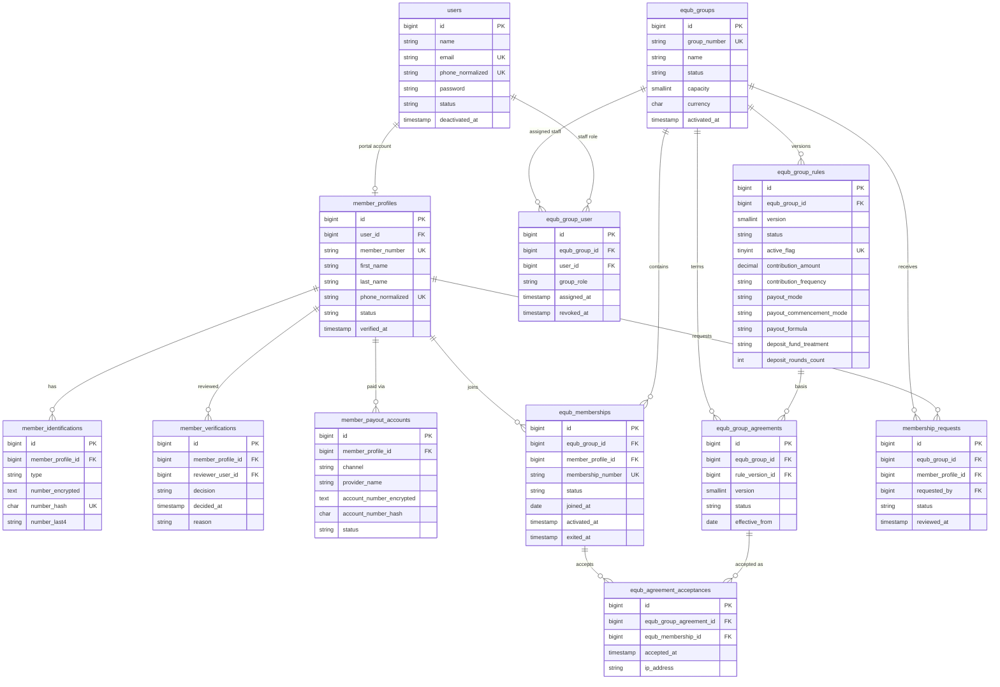
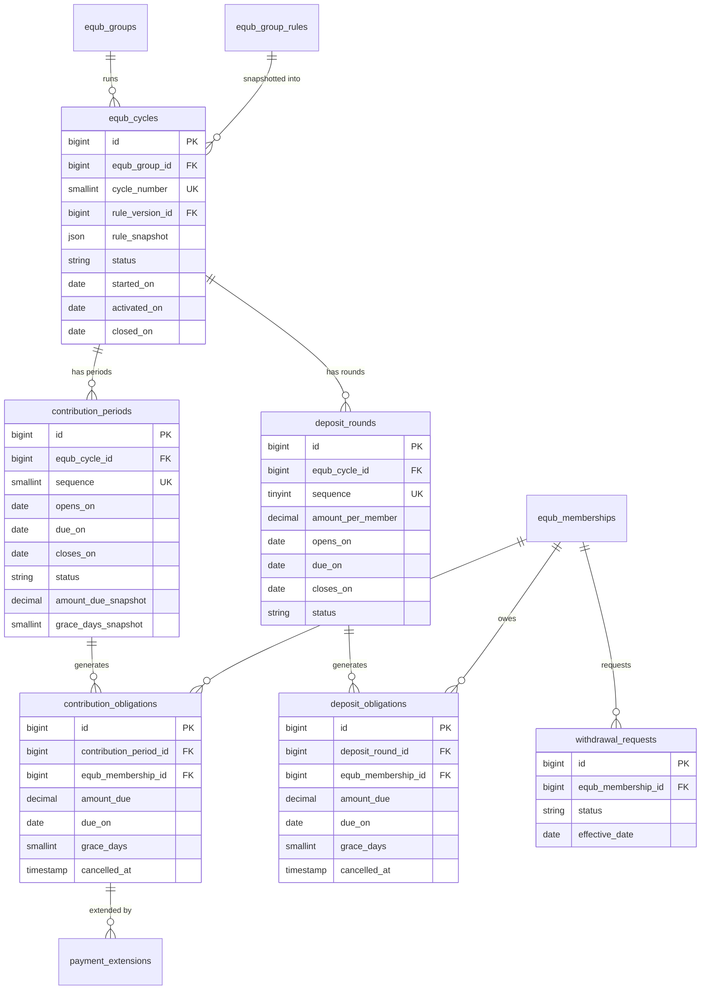
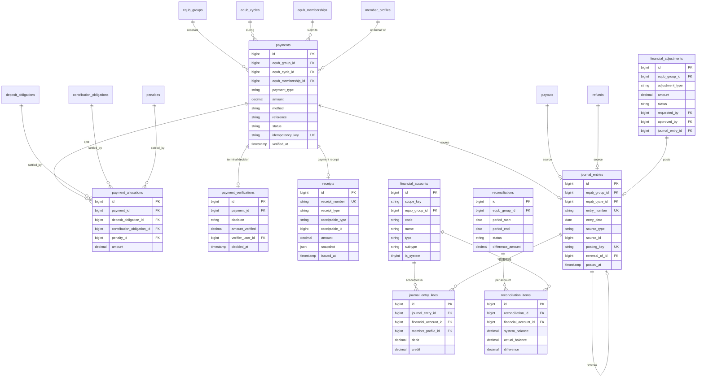
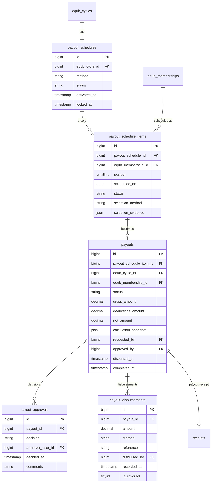
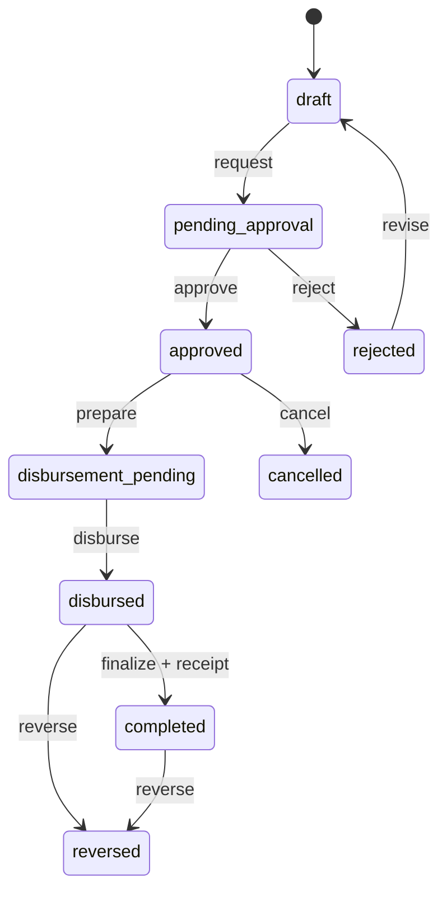
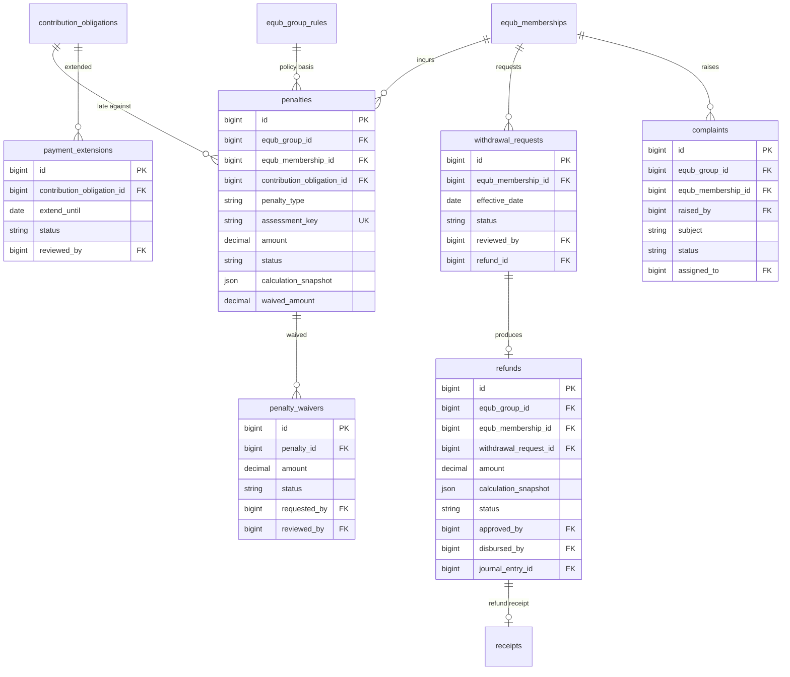
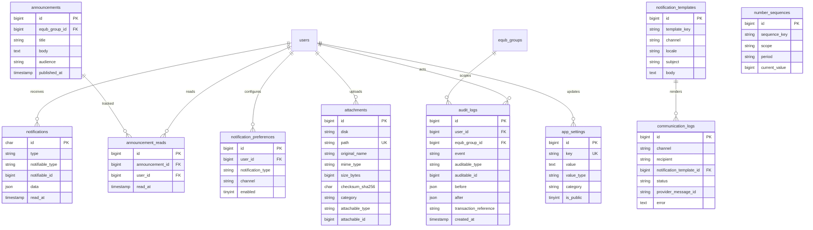
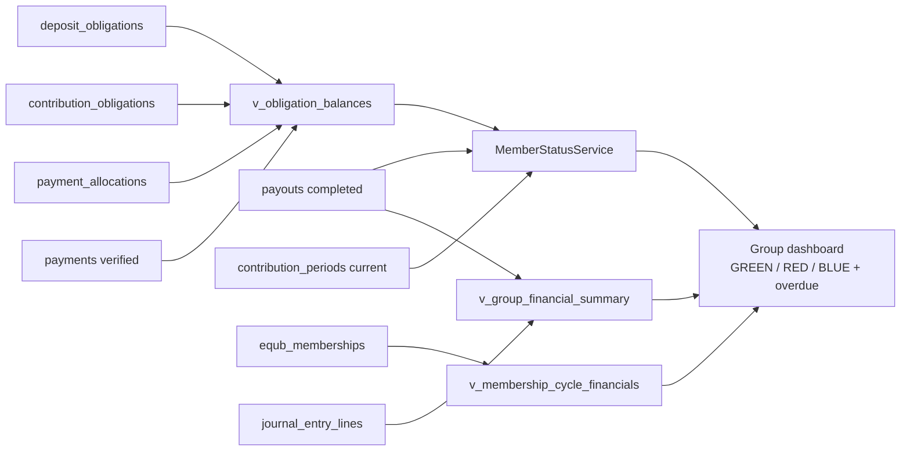

# DATABASE ERD — Digital Equb Management System

> **Status:** Phase 1 deliverable. Visual companion to `DATABASE_DESIGN.md`.
> **Notation:** Crow's-foot. `||--o{` = one-to-many, `||--||` = one-to-one, `}o--||` = many-to-one.
> Financial tables use restrictive deletes; only non-financial assignment/config children cascade.

---

## 1. Domain overview

```mermaid
erDiagram
    users ||--o{ member_profiles : "may login as"
    users ||--o{ equb_group_user : "staff assignment"
    users ||--o{ audit_logs : "acts"

    member_profiles ||--o{ member_identifications : has
    member_profiles ||--o{ member_verifications : "KYC decisions"
    member_profiles ||--o{ member_payout_accounts : "receives via"
    member_profiles ||--o{ equb_memberships : joins
    member_profiles ||--o{ payments : makes
    member_profiles ||--o{ receipts : "issued to"
    member_profiles ||--o{ journal_entry_lines : "sub-ledger"

    equb_groups ||--o{ equb_group_user : "staff"
    equb_groups ||--o{ equb_group_rules : "versioned rules"
    equb_groups ||--o{ equb_group_agreements : agreements
    equb_groups ||--o{ equb_memberships : contains
    equb_groups ||--o{ equb_cycles : runs
    equb_groups ||--o{ financial_accounts : "chart of accounts"
    equb_groups ||--o{ payments : "receives"
    equb_groups ||--o{ payouts : "disburses"
    equb_groups ||--o{ penalties : assesses
    equb_groups ||--o{ refunds : pays

    equb_cycles ||--o{ contribution_periods : schedules
    equb_cycles ||--o{ deposit_rounds : schedules
    equb_cycles ||--o{ payout_schedules : "one per cycle"
    equb_cycles ||--o{ payouts : "one per member"
    equb_cycles ||--o{ financial_adjustments : corrects
    equb_cycles ||--o{ reconciliations : "reviewed"

    contribution_periods ||--o{ contribution_obligations : "due amounts"
    deposit_rounds ||--o{ deposit_obligations : "due amounts"
    equb_memberships ||--o{ contribution_obligations : owes
    equb_memberships ||--o{ deposit_obligations : owes
    equb_memberships ||--o{ penalties : "may incur"
    equb_memberships ||--o{ withdrawal_requests : requests

    payments ||--o{ payment_allocations : allocates
    payments ||--o| payment_verifications : "decided by"
    payment_allocations }o--o| contribution_obligations : settles
    payment_allocations }o--o| deposit_obligations : settles
    payment_allocations }o--o| penalties : settles

    payout_schedules ||--o{ payout_schedule_items : orders
    payout_schedule_items ||--o| payouts : "becomes"
    payouts ||--o{ payout_approvals : "decided"
    payouts ||--o{ payout_disbursements : "paid by"
    payouts ||--o| receipts : "receipt"

    journal_entries ||--o{ journal_entry_lines : "balanced lines"
    financial_accounts ||--o{ journal_entry_lines : "posted to"
    journal_entries ||--o| journal_entries : "reversal of"

    withdrawal_requests ||--o| refunds : "may produce"
    refunds ||--o| receipts : "receipt"
    penalties ||--o{ penalty_waivers : "waived by"
    contribution_obligations ||--o{ payment_extensions : "extended"

    announcements ||--o{ announcement_reads : "read by"
```

---

## 2. Identity, members, and groups

**Key constraints**

- `users.email` unique nullable; `users.phone_normalized` unique nullable.
- `member_profiles.phone_normalized` unique (duplicate detection).
- `member_identifications.number_hash` unique (duplicate detection without exposing raw ID).
- `equb_group_rules (equb_group_id, version)` unique; `(equb_group_id, active_flag)` unique for a single active version.
- `equb_memberships (equb_group_id, member_profile_id)` unique.
- `equb_group_user (equb_group_id, user_id, group_role)` unique; revocation uses `revoked_at`.

---

## 3. Cycles, periods, obligations

**Key constraints**

- `equb_cycles (equb_group_id, cycle_number)` unique.
- `contribution_periods (equb_cycle_id, sequence)` unique; `(equb_cycle_id, due_on)` unique.
- `deposit_rounds (equb_cycle_id, sequence)` unique.
- `contribution_obligations (contribution_period_id, equb_membership_id)` unique.
- `deposit_obligations (deposit_round_id, equb_membership_id)` unique.
- Date checks: `opens_on <= due_on <= closes_on`.
- Obligations snapshot `amount_due`, `due_on`, `grace_days`; rule changes never rewrite them.

---

## 4. Payments and finance

**Key constraints**

- `payments.idempotency_key` unique.
- `payment_verifications.payment_id` unique (one terminal decision per payment row).
- `payment_allocations`: exactly one of `deposit_obligation_id`, `contribution_obligation_id`, `penalty_id` is set.
- `journal_entries.posting_key` unique.
- `journal_entry_lines`: one-sided debit/credit, total debits = total credits per entry.
- `receipts.receipt_number` unique; `(receiptable_type, receiptable_id)` unique.
- `financial_accounts (scope_key, code)` unique.
- `reconciliation_items (reconciliation_id, financial_account_id)` unique.

---

## 5. Payouts

**Key constraints**

- `payout_schedules.equb_cycle_id` unique (one schedule per cycle).
- `payout_schedule_items (payout_schedule_id, position)` unique.
- `payout_schedule_items (payout_schedule_id, equb_membership_id)` unique — one payout per member per cycle by default.
- `payouts.payout_schedule_item_id` unique.
- `payouts.net_amount = gross_amount - deductions_amount`.
- One non-reversal disbursement per payout (generated key or service + status).
- `completed_at` only set after a non-reversal disbursement exists.

**State machine (payout)**

> BLUE is set only at `disbursed`/`completed`, never at `approved`.

---

## 6. Penalties, exits, refunds, complaints

**Key constraints**

- `penalties.assessment_key` unique (idempotent scheduler).
- Waivers cannot exceed the penalty remaining amount (service invariant).
- `refunds.withdrawal_request_id` unique (one refund per withdrawal case).
- Refunds cannot be disbursed without approval and a ledger posting.

---

## 7. Communication, settings, audit

**Key constraints**

- `notification_preferences (user_id, notification_type, channel)` unique.
- `notification_templates (template_key, channel, locale)` unique.
- `announcement_reads (announcement_id, user_id)` unique.
- `app_settings.key` unique.
- `number_sequences (sequence_key, scope, period)` unique.
- `attachments.path` unique; `checksum_sha256` indexed.

---

## 8. Full relationship index

| Parent                     | Child                        | Cardinality         | FK action           |
| -------------------------- | ---------------------------- | ------------------- | ------------------- |
| `users`                    | `member_profiles`            | 1 : 0..1            | RESTRICT            |
| `users`                    | `equb_group_user`            | 1 : n               | CASCADE             |
| `users`                    | `audit_logs`                 | 1 : n               | SET NULL / RESTRICT |
| `member_profiles`          | `member_identifications`     | 1 : n               | RESTRICT            |
| `member_profiles`          | `member_verifications`       | 1 : n               | RESTRICT            |
| `member_profiles`          | `member_payout_accounts`     | 1 : n               | RESTRICT            |
| `member_profiles`          | `equb_memberships`           | 1 : n               | RESTRICT            |
| `member_profiles`          | `payments`                   | 1 : n               | RESTRICT            |
| `member_profiles`          | `receipts`                   | 1 : n               | RESTRICT            |
| `member_profiles`          | `journal_entry_lines`        | 1 : n               | RESTRICT            |
| `equb_groups`              | `equb_group_user`            | 1 : n               | CASCADE             |
| `equb_groups`              | `equb_group_rules`           | 1 : n               | RESTRICT            |
| `equb_groups`              | `equb_group_agreements`      | 1 : n               | RESTRICT            |
| `equb_groups`              | `equb_memberships`           | 1 : n               | RESTRICT            |
| `equb_groups`              | `membership_requests`        | 1 : n               | RESTRICT            |
| `equb_groups`              | `equb_cycles`                | 1 : n               | RESTRICT            |
| `equb_groups`              | `financial_accounts`         | 1 : n               | RESTRICT            |
| `equb_groups`              | `payments`                   | 1 : n               | RESTRICT            |
| `equb_groups`              | `payout_schedules`           | 1 : n (via cycles)  | RESTRICT            |
| `equb_groups`              | `penalties`                  | 1 : n               | RESTRICT            |
| `equb_groups`              | `refunds`                    | 1 : n               | RESTRICT            |
| `equb_groups`              | `complaints`                 | 1 : n               | RESTRICT            |
| `equb_groups`              | `audit_logs`                 | 1 : n               | RESTRICT/SET NULL   |
| `equb_group_rules`         | `equb_cycles`                | 1 : n               | RESTRICT            |
| `equb_group_rules`         | `equb_group_agreements`      | 1 : n               | RESTRICT            |
| `equb_group_agreements`    | `equb_agreement_acceptances` | 1 : n               | RESTRICT            |
| `equb_memberships`         | `equb_agreement_acceptances` | 1 : n               | RESTRICT            |
| `equb_memberships`         | `deposit_obligations`        | 1 : n               | RESTRICT            |
| `equb_memberships`         | `contribution_obligations`   | 1 : n               | RESTRICT            |
| `equb_memberships`         | `payments`                   | 1 : n               | RESTRICT            |
| `equb_memberships`         | `payout_schedule_items`      | 1 : n               | RESTRICT            |
| `equb_memberships`         | `payouts`                    | 1 : n               | RESTRICT            |
| `equb_memberships`         | `penalties`                  | 1 : n               | RESTRICT            |
| `equb_memberships`         | `withdrawal_requests`        | 1 : n               | RESTRICT            |
| `equb_memberships`         | `refunds`                    | 1 : n               | RESTRICT            |
| `equb_memberships`         | `complaints`                 | 1 : n               | RESTRICT            |
| `equb_cycles`              | `contribution_periods`       | 1 : n               | RESTRICT            |
| `equb_cycles`              | `deposit_rounds`             | 1 : n               | RESTRICT            |
| `equb_cycles`              | `payments`                   | 1 : n               | RESTRICT            |
| `equb_cycles`              | `payout_schedules`           | 1 : 1               | RESTRICT            |
| `equb_cycles`              | `payouts`                    | 1 : n               | RESTRICT            |
| `equb_cycles`              | `financial_adjustments`      | 1 : n               | RESTRICT            |
| `equb_cycles`              | `reconciliations`            | 1 : n               | RESTRICT            |
| `contribution_periods`     | `contribution_obligations`   | 1 : n               | RESTRICT            |
| `deposit_rounds`           | `deposit_obligations`        | 1 : n               | RESTRICT            |
| `contribution_obligations` | `payment_allocations`        | 1 : n               | RESTRICT            |
| `deposit_obligations`      | `payment_allocations`        | 1 : n               | RESTRICT            |
| `penalties`                | `payment_allocations`        | 1 : n               | RESTRICT            |
| `penalties`                | `penalty_waivers`            | 1 : n               | RESTRICT            |
| `contribution_obligations` | `payment_extensions`         | 1 : n               | RESTRICT            |
| `payments`                 | `payment_allocations`        | 1 : n               | RESTRICT            |
| `payments`                 | `payment_verifications`      | 1 : 0..1            | RESTRICT            |
| `payments`                 | `receipts`                   | 1 : 0..1            | RESTRICT            |
| `payments`                 | `journal_entries`            | 1 : n (source)      | RESTRICT            |
| `payout_schedules`         | `payout_schedule_items`      | 1 : n               | RESTRICT            |
| `payout_schedule_items`    | `payouts`                    | 1 : 0..1            | RESTRICT            |
| `payouts`                  | `payout_approvals`           | 1 : n               | RESTRICT            |
| `payouts`                  | `payout_disbursements`       | 1 : n               | RESTRICT            |
| `payouts`                  | `receipts`                   | 1 : 0..1            | RESTRICT            |
| `payouts`                  | `journal_entries`            | 1 : n (source)      | RESTRICT            |
| `refunds`                  | `receipts`                   | 1 : 0..1            | RESTRICT            |
| `refunds`                  | `journal_entries`            | 1 : n (source)      | RESTRICT            |
| `financial_accounts`       | `journal_entry_lines`        | 1 : n               | RESTRICT            |
| `journal_entries`          | `journal_entry_lines`        | 1 : n               | RESTRICT            |
| `journal_entries`          | `journal_entries`            | 1 : 0..1 (reversal) | RESTRICT            |
| `financial_adjustments`    | `journal_entries`            | 1 : 0..1            | RESTRICT            |
| `reconciliations`          | `reconciliation_items`       | 1 : n               | RESTRICT            |
| `financial_accounts`       | `reconciliation_items`       | 1 : n               | RESTRICT            |
| `withdrawal_requests`      | `refunds`                    | 1 : 0..1            | RESTRICT            |
| `announcements`            | `announcement_reads`         | 1 : n               | CASCADE             |
| `users`                    | `notifications`              | 1 : n               | CASCADE             |
| `notification_templates`   | `communication_logs`         | 1 : n               | SET NULL            |

---

## 9. Cardinality rules that matter financially

1. **One membership per member per group.** Rejoining reactivates the same membership row so obligations and history remain continuous.
2. **One deposit obligation per membership per round.** Idempotent generation cannot duplicate dues.
3. **One contribution obligation per membership per period.** Same reason.
4. **One payout schedule per cycle.**
5. **One schedule item per membership per cycle (default).** Enforced by a unique key, not just service logic.
6. **One payout case per schedule item.**
7. **One terminal verification per payment.** Corrections create new payment records plus ledger adjustments.
8. **One receipt per financial source.** Receipts are never renumbered.
9. **One active rule version per group.** Enforced by the `active_flag` unique trick.
10. **One refund per withdrawal case.**
11. **One penalty per assessment key.** Prevents scheduler duplication.
12. **One ledger posting per `posting_key`.** Prevents double posting on retry.

---

## 10. Derived read models

No persisted color, obligation balance, or available-funds column exists. Any materialized cache must be rebuildable and invalidated by the events listed in `SYSTEM_ARCHITECTURE.md` §8.

---

## 11. ERD verification checklist

- [ ] Every financial FK is `RESTRICT` (no cascade toward money).
- [ ] Every money column is `DECIMAL(15,2)` with an explicit currency.
- [ ] Every financial state change has an allowed-transition map in a PHP enum.
- [ ] Every duplicate-sensitive operation has a unique key, not just a service check.
- [ ] Every posted journal entry is balanced and immutable.
- [ ] Every completed payout has a disbursement row.
- [ ] Every verified payment has a verification row.
- [ ] Every rule version used by a cycle is snapshotted.
- [ ] Every group-scoped query can join to `equb_group_id` without ambiguity.
- [ ] No table stores a member color or a mutable "paid" boolean.
