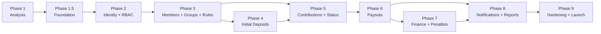

# IMPLEMENTATION ROADMAP — Digital Equb Management System

> **Status:** Phase 1 deliverable (proposed plan; not yet approved).
> **Current position:** Phase 1 analysis complete. No application code has been modified.
> **Principle:** Controlled phases with verified exit criteria. No big-bang delivery.

---

## 1. How to read this roadmap

- Each phase is a shippable, testable increment.
- A phase starts only when the previous phase's **exit criteria** pass.
- Financial workflows (E, F, H, I) never start before their **decision gates** are answered.
- Every phase ends with the same verification battery: migrations, tests, type checks, formatting, static analysis, route review, authorization tests, and a written summary of what changed.
- Scope is expressed as **requirements IDs** from `REQUIREMENTS.md` where possible.

**Status legend:** ✅ done · 🔜 next · ⬜ planned · ⛔ blocked on decision.

---

## 2. Phase summary

| Phase   | Name                               | Theme                                                | Depends on | Decision gates         |
| ------- | ---------------------------------- | ---------------------------------------------------- | ---------- | ---------------------- |
| **1**   | Analysis and architecture          | Documents only                                       | —          | —                      |
| **1.5** | Foundation hardening               | Green baseline + security                            | 1          | D-11                   |
| **2**   | Identity, RBAC, application shell  | Users, roles, policies, navigation                   | 1.5        | D-10, D-12, D-14       |
| **3**   | Members, groups, rules, enrollment | Core master data                                     | 2          | D-04, D-13             |
| **4**   | Initial deposits                   | Deposit rounds + verified payments                   | 3          | D-01, D-05, D-16       |
| **5**   | Contributions and member status    | Periods, obligations, GREEN/RED/BLUE                 | 3, 4       | D-03, D-05, D-16       |
| **6**   | Payouts                            | Schedule, approval, disbursement                     | 5          | D-02, D-06, D-09, D-17 |
| **7**   | Finance, penalties, exits          | Ledger hardening, penalties, refunds, reconciliation | 6          | D-07, D-08, D-18, D-19 |
| **8**   | Notifications, reports, exports    | Communication + read models                          | 6, 7       | D-15                   |
| **9**   | Hardening, UAT, launch             | Security, performance, operations                    | all        | D-19, D-20             |

---

## 3. Phase 1 — Analysis and architecture ✅

### Deliverables

| Document                    | Purpose                                                             | Status |
| --------------------------- | ------------------------------------------------------------------- | ------ |
| `PROJECT_ANALYSIS.md`       | Existing system assessment, risks, verified baseline                | ✅     |
| `REQUIREMENTS.md`           | Functional/non-functional requirements, role matrix, open decisions | ✅     |
| `SYSTEM_ARCHITECTURE.md`    | Modules, layers, services, security, frontend, ADRs                 | ✅     |
| `DATABASE_DESIGN.md`        | Table-level schema, constraints, ledger, invariants                 | ✅     |
| `DATABASE_ERD.md`           | Visual domain ERDs and cardinality rules                            | ✅     |
| `BUSINESS_WORKFLOWS.md`     | Workflows A–I with states, ledger effects, tests                    | ✅     |
| `IMPLEMENTATION_ROADMAP.md` | This plan                                                           | ✅     |

### Verified evidence

- `npm install --no-package-lock` → 245 packages, 0 vulnerabilities.
- `npm run build` → success; `public/build/manifest.json` and assets emitted.
- `php artisan test` → **42 passed, 147 assertions**.
- `npm run types:check` → pass.
- Wayfinder output generated (gitignored).

### Exit criteria

- [x] All seven documents exist and cross-reference consistently.
- [x] Runtime baseline verified with exact commands.
- [x] No application code modified.
- [x] Open decisions documented with safe defaults.

### Known carry-over

- No JS lockfile committed (intentional during Phase 1).
- `npm run check` reports Markdown formatting differences (will be fixed with `vp check --fix`).
- Font build warning about optional `fontaine` package (cosmetic).

---

## 4. Phase 1.5 — Foundation hardening ✅

**Goal:** A secure, reproducible, green baseline before domain code.

**Estimated size:** Small (1–2 focused days). No financial schema yet.

### Scope

| #      | Task                                 | Detail                                                                                                                          |
| ------ | ------------------------------------ | ------------------------------------------------------------------------------------------------------------------------------- |
| 1.5.1  | Commit lockfile                      | Run `npm install`, commit `package-lock.json`; standardize on npm (pnpm absent).                                                |
| 1.5.2  | Disable public registration          | Remove `Features::registration()` from `config/fortify.php`; remove registration route/UI; keep invitation/admin creation path. |
| 1.5.3  | Install Spatie                       | `composer require spatie/laravel-permission`; publish config/migration; run migration; add `HasRoles` to `User`.                |
| 1.5.4  | Seed roles/permissions               | Six roles + granular permission list from `REQUIREMENTS.md`; idempotent seeder.                                                 |
| 1.5.5  | Replace destructive account deletion | Remove self-service hard delete; implement deactivation model + `users.status`; protect financial FKs.                          |
| 1.5.6  | Harden user status                   | Add `status`, `deactivated_at`, `must_change_password`; `EnsureUserIsActive` middleware; session invalidation.                  |
| 1.5.7  | Add `notifications` table            | Laravel database notifications migration.                                                                                       |
| 1.5.8  | Fix environment docs                 | Update `.env.example` to match MySQL; document session/cache/queue; README setup section.                                       |
| 1.5.9  | Timezone/currency defaults           | `APP_TIMEZONE=UTC`, display timezone config, ETB setting placeholder.                                                           |
| 1.5.10 | Decide SSR                           | Disable SSR for initial development (recommended) or add SSR runbook.                                                           |
| 1.5.11 | Enable audit foundation              | `audit_logs` migration + `AuditService` + observers for user/role changes.                                                      |
| 1.5.12 | CI improvements                      | Commit lockfile, run build before tests, align Node major, cache dependencies.                                                  |
| 1.5.13 | Formatting                           | `npm run check -- --fix` (or `vp check --fix`) so the gate is green.                                                            |
| 1.5.14 | Security headers baseline            | Middleware for CSP/`X-Content-Type-Options`/`Referrer-Policy` (report-only CSP initially).                                      |

### Migrations added

`add_status_to_users`, `create_audit_logs_table`, `create_notifications_table`, Spatie permission tables.

### Routes/pages

- Remove `/register` and registration page.
- Deactivation replaces delete on the profile/security page.
- No domain routes yet.

### Exit criteria

- [x] `php artisan test` green.
- [x] `npm run build` green.
- [x] `npm run types:check` green.
- [x] `npm run check` green (formatting/lint).
- [x] `vendor/bin/pint --test` green.
- [x] `vendor/bin/phpstan analyse` (Larastan) green.
- [x] `/register` returns 404/403; admin-created user flow works.
- [x] Role/permission seeder is idempotent (run twice).
- [x] Account deactivation revokes sessions and blocks login.
- [x] README documents setup on Windows/PowerShell and Linux.

### Decision gate

- **D-11 Public registration** — must be **disabled** for this system (recommended; confirm).

---

## 5. Phase 2 — Identity, RBAC, and application shell

**Goal:** Every user has the right access; navigation and dashboards are permission-aware; audit is wired.

**Estimated size:** Medium.

### Scope

| Area              | Work                                                                                                          |
| ----------------- | ------------------------------------------------------------------------------------------------------------- |
| Users             | Admin CRUD, activation, lockout, password reset, invitations, role assignment                                 |
| Roles/permissions | Spatie UI (list roles, assign permissions), audited changes, cache invalidation                               |
| Policies          | `UserPolicy`, `SettingPolicy`, `AuditLogPolicy`, base policy conventions                                      |
| Group scoping     | `equb_group_user` migration + `EnsureGroupAccess` middleware (no groups UI yet)                               |
| Middleware        | `EnsureUserIsActive`, `permission:`, `password.confirm`, throttles                                            |
| Shared props      | Auth user, roles, permissions, flash, organization, timezone                                                  |
| Layouts           | `AppLayout`, `AuditorLayout` (read-only banner), `MemberLayout` skeleton, `AuthLayout`                        |
| Navigation        | Permission-filtered sidebar groups: Overview, Operations, Finance, Insights, Administration                   |
| Dashboard         | Authenticated placeholder with KPI slots (no financial data yet)                                              |
| UI primitives     | `DataTable`, `PageHeader`, `SummaryCard`, `StatusBadge`, `Money`, `EmptyState`, `ConfirmDialog`, `MoneyInput` |
| Audit             | Login events, user/role changes, sensitive access                                                             |
| MFA               | Require MFA for privileged roles (configurable enforcement)                                                   |
| Tests             | Authorization matrix tests, route protection, role seeder, audit                                              |

### Migrations

`create_equb_group_user_table` (if not created in Phase 1.5), any user columns.

### Routes/pages

`admin/users`, `admin/roles`, `admin/permissions`, `profile`, `security`, `dashboard`, 403 page.

### Exit criteria

- [ ] Every admin route has a policy and a test.
- [ ] Direct URL access by unauthorized roles returns 403.
- [ ] Role/permission changes are audited and invalidate cache.
- [ ] Navigation hides unavailable modules; labels remain visible where appropriate.
- [ ] Auditor sees read-only shell and cannot mutate.
- [ ] Invitation/reset flows work with queued mail (log driver locally).
- [ ] MFA enforcement verified for privileged roles.
- [ ] TypeScript strict + tests green.

### Decision gates

- **D-10 Member login identifier** — decide before member portal work (email/phone/either).
- **D-12 Maker-checker policy** — defaults recorded; enforced from Phase 4 onward.
- **D-14 Calendar display** — Gregorian storage; optional Ethiopian display.

---

## 6. Phase 3 — Members, groups, rules, and enrollment

**Goal:** Complete master data needed before any money moves.

**Estimated size:** Large.

### Scope

| Area            | Work                                                                            | Requirement IDs |
| --------------- | ------------------------------------------------------------------------------- | --------------- |
| Members         | CRUD, member numbers, duplicate detection, KYC records, payout accounts, status | MEM-01..14      |
| Groups          | CRUD, lifecycle draft→ready, capacity, staff assignment, timeline               | GRP-01..12      |
| Rules           | Versioned rule editor, validation, activation, agreement versions               | RULE-01..18     |
| Enrollment      | Requests, approval, invitations, agreement acceptance, suspension/withdrawal    | ENR-01..12      |
| Files           | Private upload for KYC/agreements, MIME/size validation, signed access          | NFR-SEC-09      |
| Group dashboard | Membership grid with neutral statuses (no money yet), rule summary              | GRP-11          |
| Policies        | Member, Group, Membership, Agreement                                            | RBAC-05/06      |
| Audit           | All master-data changes, staff assignment, rule activation                      | AUD-01/03/04    |
| Tests           | Capacity race, duplicate phone/ID, rule versioning, authorization               | —               |

### Migrations

`member_profiles`, `member_identifications`, `member_verifications`, `member_payout_accounts`, `equb_groups`, `equb_group_user`, `equb_group_rules`, `equb_group_agreements`, `equb_agreement_acceptances`, `equb_memberships`, `membership_requests`, `attachments`.

### Routes/pages

`members/*`, `groups/*`, `groups/rules`, `groups/members`, `groups/staff`, `groups/agreements`, `memberships/requests`, `member/*` skeleton.

### Exit criteria

- [ ] A group cannot activate without a complete rule version and accepted agreement.
- [ ] `undecided` policies are visibly blocking, not defaulted.
- [ ] Rule edits on active versions create drafts; history is inspectable.
- [ ] Capacity is enforced under concurrency.
- [ ] Duplicate members are detected with an audited override.
- [ ] KYC/account numbers are encrypted and masked.
- [ ] Auditor read-only; organizer scoped to assigned groups.
- [ ] Tests cover all policies and state transitions.

### Decision gates

- **D-04 Multiple group membership** — allowed/limited.
- **D-13 Staff as members / conflicting roles** — policy.

---

## 7. Phase 4 — Initial deposits

**Goal:** Configurable 0..n deposit rounds with verified payments and separate accounting.

**Estimated size:** Large.

### Scope

| Area           | Work                                                               | Requirement IDs      |
| -------------- | ------------------------------------------------------------------ | -------------------- |
| Cycles         | Create cycle, rule snapshot, deposit-stage lifecycle               | GRP-07               |
| Rounds         | Create 0..n rounds, open/close, obligation generation              | DEP-01/02/07/08      |
| Payments       | Submission, evidence, verification/rejection, idempotency          | DEP-03/04/12, CON-13 |
| Receipts       | Deposit receipts with immutable snapshots                          | DEP-10, CON-08       |
| Finance        | Chart of accounts seeding, ledger posting on verification          | FIN-01/02/03         |
| Stage approval | Explicit approval with gate checks                                 | DEP-09               |
| Separation     | Deposit vs contribution accounts/reports                           | DEP-11               |
| Policy         | Deposit fund treatment remains `undecided` until confirmed         | DEP-13               |
| Notifications  | Deposit due/verified/rejected                                      | NOT-02/03            |
| Tests          | Unverified exclusion, duplicate reference, round count, separation | —                    |

### Migrations

`equb_cycles`, `contribution_periods` (structure only if needed later), `deposit_rounds`, `deposit_obligations`, `financial_accounts`, `journal_entries`, `journal_entry_lines`, `payments`, `payment_allocations`, `payment_verifications`, `receipts`, `number_sequences`.

### Routes/pages

`groups/{group}/cycles`, `groups/{group}/deposits/rounds`, `deposits/{round}`, `payments/submit`, `payments/{payment}/verify`, member deposit view.

### Exit criteria

- [ ] A group with 0 rounds works; 1, 3, and 5 rounds work identically (no hardcoded 3).
- [ ] Obligations generate exactly once under retries.
- [ ] Unverified/rejected payments never increase verified totals or ledger balances.
- [ ] Deposit balances are separate from contribution balances.
- [ ] Stage approval is blocked by unresolved D-01.
- [ ] Every verified deposit has a balanced ledger entry and a receipt.
- [ ] Maker-checker blocks self-verification when enabled.
- [ ] Financial invariant tests pass against MySQL, not only SQLite.

### Decision gates (hard blockers)

- **D-01 Deposit fund treatment** — required before stage approval/payout.
- **D-05 Partial contributions** — decides partial deposit behavior.
- **D-16 Overpayment** — decides excess handling.

---

## 8. Phase 5 — Contributions and member status

**Goal:** Recurring obligations, full payment lifecycle, and automatic GREEN/RED/BLUE.

**Estimated size:** Large.

### Scope

| Area        | Work                                                            | Requirement IDs   |
| ----------- | --------------------------------------------------------------- | ----------------- |
| Periods     | Generate from rule snapshot; open/close/lock                    | CON-01/11         |
| Obligations | Idempotent generation per active membership                     | CON-02            |
| Payments    | Same pipeline as deposits, targeted at contributions            | CON-04/05/06/12   |
| Status      | `MemberStatusService`, DTO, aggregate group counts              | STATUS-01..11     |
| Overdue     | Derived flag + scheduled marking/reminders                      | PEN-01, NOT-02/05 |
| Partial     | Allowed only when configured; allocation splitting              | CON-06            |
| Receipts    | Contribution receipts                                           | CON-08            |
| Dashboard   | Status grid, legend, filters, drill-down                        | GRP-11            |
| Tests       | Status transitions, unverified exclusion, partial, overdue+BLUE | —                 |

### Migrations

`contribution_periods`, `contribution_obligations` (final), views `v_obligation_balances`, `v_membership_cycle_financials`, indexes.

### Routes/pages

`groups/{group}/contributions/periods`, `contributions/{period}`, `member/obligations`, `member/payments`, `member/receipts`.

### Exit criteria

- [ ] Pending payment leaves member RED; verification flips to GREEN.
- [ ] Payout approval does not affect status (no payout module yet).
- [ ] Deposit stage / no open period returns NEUTRAL.
- [ ] BLUE + overdue is representable (payout test stub until Phase 6).
- [ ] Group dashboard < 500 ms for 500 members in benchmark.
- [ ] No color column exists in the schema.
- [ ] Overdue is separate from primary status in API props and UI.
- [ ] Period lock prevents new obligations.

### Decision gates

- **D-03 BLUE persistence** — scope of BLUE across cycles.
- **D-05, D-16** — confirmed behavior tests.

---

## 9. Phase 6 — Payouts

**Goal:** Safe rotation, approval, disbursement, receipts, and BLUE transition.

**Estimated size:** Large (highest financial risk).

### Scope

| Area          | Work                                                         | Requirement IDs      |
| ------------- | ------------------------------------------------------------ | -------------------- |
| Schedule      | Create/activate/lock schedule; positions; eligibility        | SCH-01/07/09         |
| Selection     | Predetermined/random/manual/hybrid with evidence             | SCH-02..06           |
| Payouts       | Request, approve, reject, disburse, complete, reverse        | PAY-01..15           |
| Funds         | `AvailableFundsService`, lock and re-check                   | PAY-04, FIN-06       |
| Formula       | Gross/deductions/net from configuration + snapshot           | PAY-03, RULE-11      |
| Separation    | Requester ≠ approver ≠ disburser where configured            | PAY-15               |
| Receipts      | Payout receipts                                              | PAY-09               |
| Status        | BLUE only on disbursement/completion                         | PAY-10, STATUS-02/08 |
| Notifications | Scheduled/approved/disbursed                                 | NOT-04               |
| Tests         | Duplicate payout, over-disbursement, approval-only, reversal | —                    |

### Migrations

`payout_schedules`, `payout_schedule_items`, `payouts`, `payout_approvals`, `payout_disbursements`, indexes/constraints.

### Routes/pages

`groups/{group}/payouts/schedule`, `payouts/{payout}`, `payouts/{payout}/approve`, `payouts/{payout}/disburse`, member payout view.

### Exit criteria

- [ ] One payout per member per cycle enforced by DB + service.
- [ ] Payout cannot exceed available eligible funds under concurrency.
- [ ] Approval alone leaves status approved and member not BLUE.
- [ ] Disbursement requires evidence and a distinct permission.
- [ ] Completion creates an immutable receipt and posts balanced ledger entries.
- [ ] Reversal restores funds and recomputes status without deleting history.
- [ ] Random selection is server-side and auditable.
- [ ] Group dashboard reflects BLUE correctly.

### Decision gates (hard blockers)

- **D-02 Payout commencement** — conditions.
- **D-06 Recipient selection** — allowed methods.
- **D-09 Payout composition** — gross/deductions.
- **D-17 Payout before full collection** — yes/no/rule.

---

## 10. Phase 7 — Finance hardening, penalties, exits

**Goal:** Complete accounting controls, penalties, refunds, and reconciliation.

**Estimated size:** Large.

### Scope

| Area           | Work                                                                | Requirement IDs |
| -------------- | ------------------------------------------------------------------- | --------------- |
| Ledger         | Posting adapter per event, trial balance, reversal UI               | FIN-02..06/14   |
| Adjustments    | Maker-checker adjustments, reason, posting                          | FIN-11, ADJ     |
| Reconciliation | Prepare/review/approve; differences block closure                   | FIN-12          |
| Penalties      | Assessment, caps, waivers, extensions                               | PEN-01..07      |
| Withdrawals    | Request, approve, refund calculation, disbursement                  | PEN-08/09/12    |
| Refunds        | Ledger-linked, receipted, reversible                                | FIN-10          |
| Complaints     | Record, assign, resolve                                             | PEN-11          |
| Reports        | Ledger, trial balance, collections, payouts, outstanding            | FIN-14          |
| Tests          | Balanced entries, idempotent penalties, refund caps, closure blocks | —               |

### Migrations

`financial_adjustments`, `reconciliations`, `reconciliation_items`, `penalties`, `penalty_waivers`, `payment_extensions`, `withdrawal_requests`, `refunds`, `complaints`.

### Routes/pages

`finance/ledger`, `finance/accounts`, `finance/adjustments`, `finance/reconciliation`, `penalties/*`, `withdrawals/*`, `refunds/*`, `complaints/*`.

### Exit criteria

- [ ] Every posted entry balances; a nightly integrity check reports zero violations.
- [ ] Posted entries are immutable in code and protected in production DB privileges.
- [ ] Penalty reruns create no duplicates.
- [ ] Waivers/refunds require approval and post ledger entries.
- [ ] Refund cannot exceed policy-eligible amount.
- [ ] Reconciliation difference blocks cycle closure.
- [ ] Auditor can review but not mutate.

### Decision gates (hard blockers)

- **D-07 Penalties** — mandatory/configurable/none.
- **D-08 Withdrawal/refund formula**.
- **D-18 Penalty deduction from payout**.
- **D-19 Retention/anonymization** (policy starts here; enforcement in Phase 9).

---

## 11. Phase 8 — Notifications, reports, and exports

**Goal:** Operational communication and decision-ready reporting.

**Estimated size:** Medium.

### Scope

| Area           | Work                                                                                  | Requirement IDs |
| -------------- | ------------------------------------------------------------------------------------- | --------------- |
| Notifications  | Preferences, templates, delivery log, announcement read tracking                      | NOT-01..12      |
| Email          | Queued templates, branded layout, local log driver                                    | NOT-09/11       |
| SMS            | Provider contract + adapter stub; disabled until configured                           | NOT-12          |
| Scheduled jobs | Due reminders, overdue scans, payout notices, failed-job alerts                       | NOT-02/04/05    |
| Reports        | Member, group, deposit, contribution, payout, unpaid aging, penalty, financial, audit | REP-01..10      |
| Exports        | PDF (DomPDF decision) and Excel/CSV, queued, audited                                  | REP-12/13       |
| Drill-down     | Summary → detail with permission scoping                                              | REP-15          |
| Tests          | Notification dedupe, export permissions, report totals vs ledger                      | —               |

### Migrations

`notification_preferences`, `notification_templates`, `communication_logs`, `announcements`, `announcement_reads`.

### Packages (only now)

- `barryvdh/laravel-dompdf` (or `spatie/laravel-pdf` if headless Chrome is approved).
- `maatwebsite/excel` for `.xlsx`.
- SMS provider SDK only after D-15.

### Exit criteria

- [ ] Notifications are deduplicated and respect preferences (mandatory notices excepted).
- [ ] Delivery failures are visible and retryable.
- [ ] Every report/export is permission-checked and audited.
- [ ] Report totals reconcile to ledger/obligations.
- [ ] Large exports stream and do not exhaust memory.
- [ ] Receipts/statements use immutable snapshots.

### Decision gate

- **D-15 SMS/email provider** — select or keep log/email-only.

---

## 12. Phase 9 — Hardening, UAT, and launch

**Goal:** Production readiness with evidence.

**Estimated size:** Medium–large.

### Scope

| Area          | Work                                                                                                 |
| ------------- | ---------------------------------------------------------------------------------------------------- |
| Security      | Penetration-style review, CSP enforcement, dependency audit, secrets review, least-privilege DB user |
| Performance   | Load test dashboards/reports, query plans, index review, cache tuning                                |
| Reliability   | Backup/restore drill, queue failure handling, health checks, alerting                                |
| Data          | Retention/anonymization job, audit export, reconciliation sign-off                                   |
| Operations    | Deployment runbook, rollback, monitoring, on-call basics                                             |
| UAT           | Business-owner scenarios from `BUSINESS_WORKFLOWS.md` §14, sign-off                                  |
| Documentation | README, admin guide, member guide, runbook, known limitations                                        |
| Training      | Staff walkthrough for payments, payouts, reconciliation                                              |
| Go-live       | Production env checklist, smoke tests, cutover, hypercare                                            |

### Exit criteria

- [ ] UAT scenario passes end to end with real roles.
- [ ] Restore from backup verified on a clean environment.
- [ ] Security checklist signed off; no high/critical findings open.
- [ ] Performance targets met at realistic volume.
- [ ] Runbook tested by someone other than the author.
- [ ] Audit trail reviewed for completeness.
- [ ] Business owner signs off on all financial policies (D-01..D-20).
- [ ] Rollback plan and owner identified.

---

## 13. Dependency graph



Rules:

- Phase 5 may start its non-payout status logic before Phase 4 finishes only if deposit tables and payment pipeline are stable; in practice run 4 → 5.
- Phase 8 reporting needs Phase 7 ledger completeness; do not build final financial reports earlier.
- Do not merge phases to "save time"; financial risk compounds.

---

## 14. Decision gates and schedule impact

| Decision                           | Needed by    | If unanswered                                       |
| ---------------------------------- | ------------ | --------------------------------------------------- |
| D-11 Public registration           | Phase 1.5    | Registration stays enabled — **do not ship**        |
| D-10 Member login                  | Phase 2/3    | Staff-only member management; member portal delayed |
| D-12 Maker-checker                 | Phase 2      | Default: on for payouts/adjustments                 |
| D-14 Calendar                      | Phase 2      | Gregorian only                                      |
| D-04 Multi-group                   | Phase 3      | Default allow with group rule                       |
| D-13 Conflicting roles             | Phase 3      | Default forbid treasurer+auditor in same group      |
| D-01 Deposit treatment             | Phase 4 exit | Deposit stage cannot be approved; payouts blocked   |
| D-05 Partial payments              | Phase 4/5    | Default not allowed                                 |
| D-16 Overpayment                   | Phase 4/5    | Default reject                                      |
| D-03 BLUE persistence              | Phase 5      | Default per cycle                                   |
| D-02 Payout commencement           | Phase 6      | Payouts blocked                                     |
| D-06 Recipient selection           | Phase 6      | Predetermined only                                  |
| D-09 Payout composition            | Phase 6      | Payouts blocked                                     |
| D-17 Payout before full collection | Phase 6      | Default not allowed                                 |
| D-07 Penalties                     | Phase 7      | Penalties disabled (`none`)                         |
| D-08 Refund formula                | Phase 7      | Withdrawals can be requested but not processed      |
| D-18 Penalty from payout           | Phase 7      | No deduction                                        |
| D-19 Retention                     | Phase 7/9    | 7-year default; legal review                        |
| D-15 SMS/email                     | Phase 8      | In-app + email only                                 |
| D-20 Multi-org                     | Architecture | Single org v1                                       |

**Rule:** if a decision is unanswered when its gate is reached, the phase delivers everything else and stops at the gate. It does not guess.

---

## 15. Verification battery (every phase)

Run from the repository root in PowerShell:

```powershell
# 1. Backend tests
php artisan test

# 2. Migrations on a clean database (use a disposable DB)
php artisan migrate:fresh --seed

# 3. Migration rollback check
php artisan migrate:rollback --step=1
php artisan migrate

# 4. Route review (ensure no unintended public endpoints)
php artisan route:list

# 5. Formatting
vendor/bin/pint --test

# 6. Static analysis
vendor/bin/phpstan analyse

# 7. Frontend types
npm run types:check

# 8. Frontend build (also regenerates Wayfinder)
npm run build

# 9. Lint/format gate
npm run check

# 10. Dependency audit
composer audit
npm audit
```

**Additional gates for financial phases (4–7):**

```powershell
# Financial/constraint tests against MySQL, not SQLite
$env:DB_CONNECTION="mysql"
$env:DB_DATABASE="equb_test"
php artisan test --testsuite=Financial

# Ledger integrity check
php artisan equb:ledger:verify

# Duplicate/invariant scan
php artisan equb:integrity:scan
```

The custom commands (`equb:ledger:verify`, `equb:integrity:scan`) are deliverables of Phase 4/7.

---

## 16. Testing strategy by phase

| Phase | Must-have tests                                                                                                                    |
| ----- | ---------------------------------------------------------------------------------------------------------------------------------- |
| 1.5   | Auth, deactivation, registration disabled, role seeder, audit on user changes                                                      |
| 2     | Policy matrix, 403 on direct access, role cache invalidation, MFA enforcement                                                      |
| 3     | Capacity race, duplicate member/ID, rule version immutability, agreement acceptance, group scoping                                 |
| 4     | Deposit round count 0/1/3/5, obligation idempotency, unverified exclusion, duplicate reference, ledger balance, receipt uniqueness |
| 5     | Status transitions, pending ≠ GREEN, partial payments, overdue derivation, period lock, BLUE+overdue stub                          |
| 6     | Approval ≠ disbursement, duplicate payout (DB + concurrency), available funds, reversal, random selection audit                    |
| 7     | Journal balance, immutable postings, penalty idempotency, waiver separation, refund cap, reconciliation blocks closure             |
| 8     | Notification dedupe, report-to-ledger reconciliation, export authorization/audit                                                   |
| 9     | Full UAT, restore drill, load tests, security checks                                                                               |

**Test database decision:** keep SQLite for fast starter tests, but financial/constraint/concurrency suites must run on MySQL 8. CI adds a MySQL service from Phase 4 onward.

---

## 17. Risk register and mitigations

| Risk                                                  | Likelihood | Impact   | Mitigation                                                           |
| ----------------------------------------------------- | ---------- | -------- | -------------------------------------------------------------------- |
| Unresolved financial policy implemented by assumption | High       | Critical | Decision gates; `undecided` blocks; sign-off log                     |
| Duplicate payouts under concurrency                   | Medium     | Critical | Unique constraints + `lockForUpdate` + concurrency tests             |
| Unverified payments counted                           | Medium     | Critical | `payments.status` join everywhere; invariant tests; no cached totals |
| Ledger drift / unbalanced entries                     | Medium     | High     | Single posting service; nightly verify command; DB constraints       |
| Status logic diverges across screens                  | Medium     | High     | One `MemberStatusService`; no color column; shared DTO               |
| SQLite/MySQL behavior mismatch                        | High       | High     | MySQL financial test suite in CI                                     |
| Scope creep into all 16 modules at once               | High       | High     | Phase gates; small PRs; requirement traceability                     |
| Starter kit assumptions leak into domain              | Medium     | Medium   | ADRs; adapt auth/profile patterns; remove hard delete                |
| PII leakage in logs/props/exports                     | Medium     | High     | Encryption, redaction, resources, private storage, audit             |
| Insider fraud                                         | Medium     | Critical | Maker-checker, least privilege, audit, reconciliation                |
| Performance degradation on status dashboard           | Medium     | Medium   | Aggregate queries, indexes, benchmark at 500 members                 |
| Email/SMS provider delays                             | Medium     | Low      | In-app first; channel contracts; log driver                          |
| Deployment differences Windows/Linux                  | Medium     | Medium   | Environment parity, CI build artifacts, runbook                      |
| Data loss during migrations                           | Low        | Critical | Backups, forward/backward tests, no destructive prod migrations      |

---

## 18. Definition of done (per phase)

A phase is complete only when all are true:

1. Requirements in scope implemented and demonstrated.
2. Server-side authorization enforced and tested.
3. Financial operations transactional; invariant tests pass.
4. Migrations run forward and backward on clean and realistic data.
5. `php artisan test`, `npm run types:check`, `npm run build`, `npm run check`, Pint, and Larastan pass.
6. Routes reviewed; no unintended public endpoints.
7. Seeders/factories idempotent and environment-safe.
8. Audit and notification events wired.
9. Documentation updated (schema, workflow, decisions, runbook).
10. Demo script and known limitations written.
11. Business owner signs off on any policy decision introduced.

---

## 19. Immediate next actions

1. **Review this Phase 1 package** (`PROJECT_ANALYSIS.md` … `IMPLEMENTATION_ROADMAP.md`).
2. **Approve or amend** the architecture, schema, and workflow documents.
3. **Answer D-11** (disable public registration) so Phase 1.5 can start.
4. **Answer the Phase 3/4 gates** (D-01, D-04, D-05, D-13, D-16) before money modules.
5. **Authorize Phase 1.5** as a single, small pull request.
6. After Phase 1.5 is green, start Phase 2 (identity + RBAC + shell).

> No code changes should begin until the Phase 1 documents are accepted and Phase 1.5 is explicitly approved.
