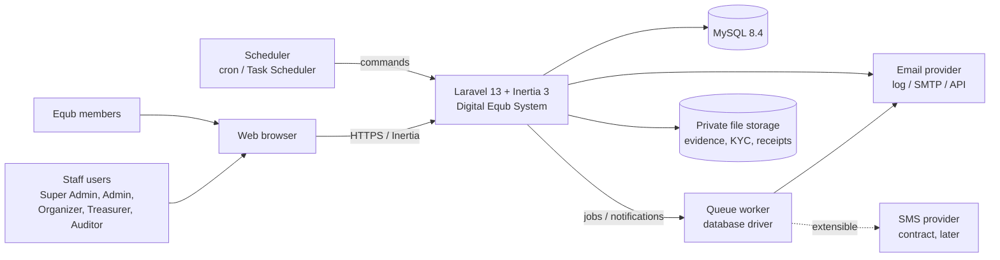
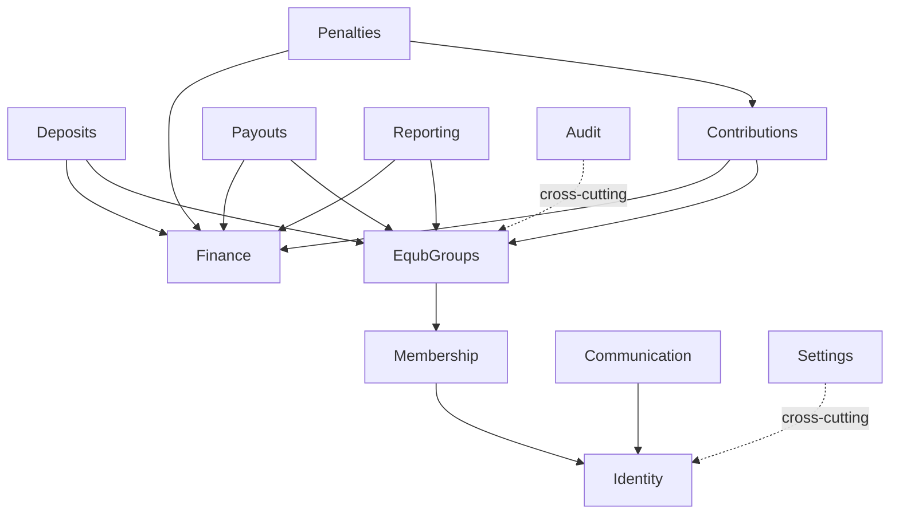
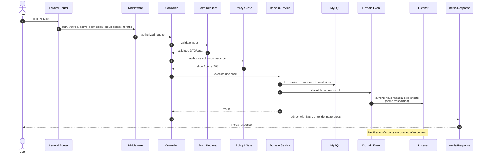
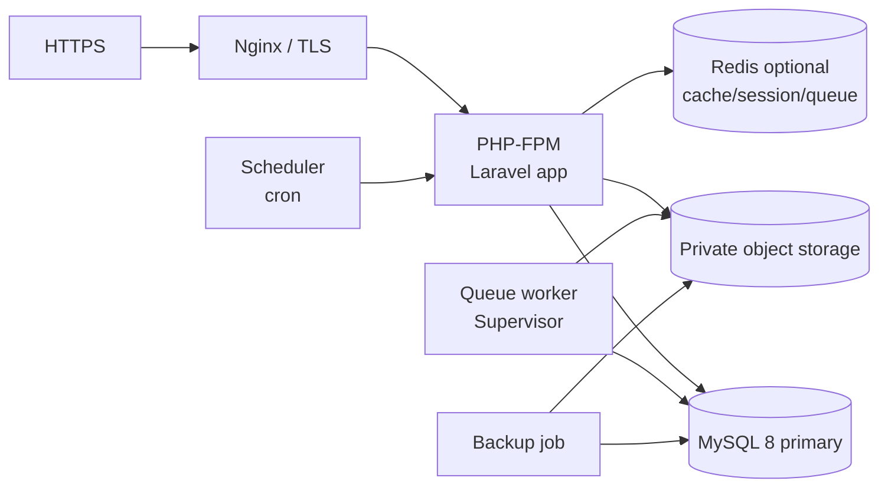

# SYSTEM ARCHITECTURE — Digital Equb Management System

> **Status:** Phase 1 deliverable (proposed architecture, not yet implemented).
> **Stack:** Laravel 13.42 · PHP 8.3+ · MySQL 8 · Inertia 3 · React 19 · TypeScript 5.7 · Tailwind CSS 4 · Spatie Laravel Permission.

---

## 1. Architecture principles

1. **Modular monolith.** One Laravel application and one database. Business behavior is separated into domain modules, not microservices.
2. **Server is the source of truth.** Financial calculations, permissions, status classification, and state transitions happen on the backend.
3. **Immutability for financial records.** Posted ledger entries, verified payments, approvals, and audit logs are never silently edited or deleted.
4. **Explicit state machines.** Every lifecycle uses a backed PHP enum and allowed transitions. Controllers do not set statuses ad hoc.
5. **Double-entry accounting.** Every money movement produces balanced journal lines. Balances are derived.
6. **Versioned financial rules.** Group rules are snapshotted into cycles/obligations so later edits cannot rewrite history.
7. **Maker-checker by default.** Recording, verifying, approving, and disbursing are separate permissions and may require different users.
8. **Defense in depth.** Policies, middleware, Form Requests, database constraints, transactions, and UI affordances all agree — but only the backend enforces security.
9. **Pragmatic Laravel conventions.** Use Laravel's built-in features before adding packages. Add only the packages the domain genuinely needs.
10. **Configurable, not hardcoded.** Unconfirmed financial policies are settings/enums that block activation until explicitly configured.

---

## 2. System context



### 2.1 Runtime components

| Component                | Responsibility                                                                    |
| ------------------------ | --------------------------------------------------------------------------------- |
| Laravel HTTP application | Authentication, authorization, validation, pages, business services.              |
| Inertia + React client   | Server-driven pages, forms, tables, dashboards. No separate SPA API required.     |
| MySQL                    | Authoritative transactional storage.                                              |
| Queue worker             | Notifications, exports, receipts, heavy reports, scheduled jobs.                  |
| Scheduler                | Opens/closes periods, marks overdue, sends reminders, runs reconciliation checks. |
| Private storage          | KYC documents, payment evidence, payout evidence, generated PDFs.                 |
| Mail/SMS adapters        | Extensible communication channels.                                                |

There is **no separate frontend server** in production. Laravel serves the Inertia shell and built assets.

---

## 3. Module boundaries

### 3.1 Backend directory layout

```
app/
├── Enums/                          # Backed enums shared across modules
│   ├── UserStatus.php
│   ├── GroupStatus.php
│   ├── GroupRole.php
│   ├── RuleStatus.php
│   ├── MembershipStatus.php
│   ├── CycleStatus.php
│   ├── PeriodStatus.php
│   ├── DepositRoundStatus.php
│   ├── ObligationStatus.php
│   ├── PaymentMethod.php
│   ├── PaymentStatus.php
│   ├── PayoutStatus.php
│   ├── ApprovalDecision.php
│   ├── PenaltyStatus.php
│   ├── WithdrawalStatus.php
│   ├── RefundStatus.php
│   └── ...
├── Models/                         # Eloquent models (schema layer)
│   ├── User.php
│   ├── MemberProfile.php
│   ├── EqubGroup.php
│   ├── EqubGroupRule.php
│   ├── EqubMembership.php
│   ├── EqubCycle.php
│   ├── ContributionPeriod.php
│   ├── DepositRound.php
│   ├── DepositObligation.php
│   ├── ContributionObligation.php
│   ├── Payment.php
│   ├── PayoutSchedule.php
│   ├── Payout.php
│   ├── JournalEntry.php
│   └── ...
├── Modules/
│   ├── Identity/
│   │   ├── Actions/
│   │   ├── Data/
│   │   ├── Events/
│   │   ├── Listeners/
│   │   └── Services/
│   ├── Membership/
│   ├── EqubGroups/
│   ├── Deposits/
│   ├── Contributions/
│   ├── Payouts/
│   ├── Finance/
│   ├── Penalties/
│   ├── Communication/
│   ├── Reporting/
│   ├── Audit/
│   └── Settings/
├── Http/
│   ├── Controllers/
│   │   ├── DashboardController.php
│   │   ├── Members/
│   │   ├── Groups/
│   │   ├── Deposits/
│   │   ├── Contributions/
│   │   ├── Payouts/
│   │   ├── Finance/
│   │   ├── Penalties/
│   │   ├── Reports/
│   │   ├── Admin/
│   │   └── MemberPortal/
│   ├── Requests/                   # Grouped by module
│   ├── Middleware/
│   │   ├── EnsureUserIsActive.php
│   │   ├── EnsureGroupAccess.php
│   │   └── ...
│   └── Resources/                  # Safe serialization for Inertia props
├── Policies/                       # Laravel policy discovery
├── Support/
│   ├── Money/
│   ├── Sequences/
│   ├── Dates/
│   ├── Files/
│   └── Exceptions/
└── Providers/
```

### 3.2 Why models stay centralized

Eloquent models form the schema layer shared by several modules. Keeping them in `app/Models`:

- preserves the existing `App\Models\User` and Fortify/passkey integration;
- keeps factories, relationships, and policy discovery conventional;
- avoids cross-module model imports and circular dependencies;
- lets modules own **behavior** (services, actions, events) where the complexity actually lives.

If a module later grows enough to justify its own models, moving them is a mechanical refactor, not an architectural rewrite.

### 3.3 Module responsibilities

| Module            | Owns                                                                                                                      | Must not own                                                                          |
| ----------------- | ------------------------------------------------------------------------------------------------------------------------- | ------------------------------------------------------------------------------------- |
| **Identity**      | Users, account status, roles/permissions integration, invitations, password policy, sessions.                             | Group financial logic.                                                                |
| **Membership**    | Member profiles, KYC verification, member numbers, membership requests, memberships, agreements, suspensions/withdrawals. | Ledger postings (delegates to Finance).                                               |
| **EqubGroups**    | Groups, staff assignments, rule versions, lifecycle, capacity, agreement documents.                                       | Payment verification.                                                                 |
| **Deposits**      | Deposit rounds, deposit obligations, stage completion.                                                                    | Payment capture/verification internals (delegates to Contributions/Payments service). |
| **Contributions** | Contribution periods, obligations, payment submission/verification, receipts.                                             | Payout approval.                                                                      |
| **Payouts**       | Schedules, rotation, eligibility, approvals, disbursement, payout receipts.                                               | Ledger implementation details (delegates to Finance).                                 |
| **Finance**       | Chart of accounts, journal entries, balances, available funds, adjustments, reversals, reconciliation, refunds.           | Deciding who is eligible for a payout.                                                |
| **Penalties**     | Penalty assessment, waivers, extensions, defaults, withdrawal/refund calculations.                                        | Direct cash movement without Finance.                                                 |
| **Communication** | Notifications, templates, preferences, announcements, SMS/email adapters, delivery logs.                                  | Business decisions.                                                                   |
| **Reporting**     | Read models, report definitions, exports, analytics queries.                                                              | Mutating financial data.                                                              |
| **Audit**         | Append-only audit trail, contextual logging, sensitive access logs.                                                       | Business workflows.                                                                   |
| **Settings**      | Organization, currency, security, receipt, notification, business defaults.                                               | Financial transactions.                                                               |

### 3.4 Dependency direction



Rules:

- A module may call another module's **public service**, never reach into its internals.
- Reporting is read-only.
- Audit and Settings are cross-cutting and must not create circular dependencies.
- Financial posting is centralized in Finance; other modules emit a `PostingRequest`, not raw journal rows.
- Domain events are used for side effects (notifications, audit, reports), not as a substitute for transaction boundaries.

---

## 4. Request lifecycle



### 4.1 Layer responsibilities

| Layer          | Responsibility                                                                                        | Must not                                                            |
| -------------- | ----------------------------------------------------------------------------------------------------- | ------------------------------------------------------------------- |
| Middleware     | Authentication, account status, coarse permissions, group access, rate limits, password confirmation. | Contain business rules.                                             |
| Form Request   | Shape and validate input; authorize request-level access.                                             | Perform financial mutations.                                        |
| Controller     | Orchestrate one use case; return Inertia/redirect.                                                    | Contain complex business logic or direct balance updates.           |
| Policy         | Decide whether this user may act on this resource/group.                                              | Decide financial validity.                                          |
| Service        | Enforce business invariants, transactions, state transitions, ledger posting.                         | Render UI.                                                          |
| Model          | Relationships, casts, scopes, simple accessors.                                                       | Multi-aggregate workflows.                                          |
| Event/Listener | React to completed domain facts; audit, notify, post secondary effects.                               | Replace the service's transaction.                                  |
| Resource       | Serialize safe fields for the frontend.                                                               | Leak sensitive columns (national ID, bank numbers, internal notes). |

### 4.2 Transaction boundaries

Use `DB::transaction()` for every use case that touches more than one financial record. Typical boundaries:

- record + verify payment + update obligation + post ledger + write audit;
- approve payout + create approval record + status transition;
- disburse payout + create disbursement + post ledger + complete payout + issue receipt + audit;
- assess penalties for a period (batch, chunked);
- close cycle + final reconciliation + status transitions.

Within the transaction:

- lock the obligation/payout/sequence rows with `lockForUpdate()`;
- re-check invariants after locking;
- rely on unique constraints as the final defense;
- dispatch synchronous financial listeners;
- queue notifications with `afterCommit`.

---

## 5. Backend services

### 5.1 Service catalog

| Service                  | Key methods (illustrative)                                                             |
| ------------------------ | -------------------------------------------------------------------------------------- |
| `MemberService`          | `register`, `update`, `verifyIdentity`, `changeStatus`, `linkUser`, `nextMemberNumber` |
| `MembershipService`      | `request`, `approve`, `reject`, `activate`, `suspend`, `withdraw`, `remove`            |
| `EqubGroupService`       | `create`, `update`, `activate`, `pause`, `complete`, `close`, `assignStaff`            |
| `GroupRuleService`       | `createDraft`, `validate`, `activateVersion`, `snapshotForCycle`                       |
| `DepositRoundService`    | `createRounds`, `open`, `generateObligations`, `close`, `approveStage`                 |
| `ContributionService`    | `generatePeriods`, `generateObligations`, `open`, `close`                              |
| `PaymentService`         | `submit`, `recordManual`, `verify`, `reject`, `reverse`                                |
| `MemberStatusService`    | `forMembership`, `forGroup`, `countsForGroup`                                          |
| `PayoutScheduleService`  | `create`, `assignRecipient`, `randomize`, `reschedule`, `validateEligibility`          |
| `PayoutService`          | `request`, `approve`, `reject`, `disburse`, `complete`, `reverse`                      |
| `FinancialLedgerService` | `post`, `reverse`, `balance`, `trialBalance`                                           |
| `AvailableFundsService`  | `forGroup`, `forCycle`, `assertSufficient`                                             |
| `PenaltyService`         | `assessForPeriod`, `waive`, `calculate`                                                |
| `WithdrawalService`      | `request`, `approve`, `reject`, `calculateRefund`                                      |
| `RefundService`          | `create`, `approve`, `disburse`                                                        |
| `ReconciliationService`  | `prepare`, `submit`, `review`, `difference`                                            |
| `NumberSequenceService`  | `next`, `peek`, `reset` (transaction-safe)                                             |
| `NotificationService`    | `send`, `notifyRole`, `announce`, `logDelivery`                                        |
| `AuditService`           | `log`, `logFinancialTransition`, `logSensitiveAccess`                                  |
| `SettingsService`        | `get`, `set`, `typed`, `forgetCache`                                                   |

### 5.2 Service design rules

- Services accept **IDs or loaded models**, not HTTP requests.
- Services return domain results/DTOs; controllers translate to Inertia props.
- Services throw domain exceptions; the exception handler maps them to user-friendly 422/409 responses.
- Services never trust the client for amounts, eligibility, balances, or status.
- Public methods are use cases; private methods are implementation details.
- Money is handled through a `Money` value object; no float math.
- Every financial service accepts an optional **actor** and **reason/context** for audit.

### 5.3 `MemberStatusService` (critical)

```php
final class MemberStatusService
{
    public function forMembership(
        EqubMembership $membership,
        EqubCycle $cycle,
    ): MemberCycleStatus {
        // 1. If a completed payout exists for this membership in this cycle → BLUE.
        // 2. Else if the current period's obligation is fully verified → GREEN.
        // 3. Else → RED.
        // Always compute the overdue flag separately.
    }
}
```

Returned DTO (illustrative):

```ts
type MemberCycleStatus = {
    status:
        | 'CONTRIBUTION_CLEARED'
        | 'CONTRIBUTION_OUTSTANDING'
        | 'PAYOUT_RECEIVED'
        | 'NOT_APPLICABLE';
    color: 'green' | 'red' | 'blue' | 'neutral'; // presentation mapping only
    isOverdue: boolean;
    currentPeriod: { id: number; label: string; dueOn: string } | null;
    obligation: { due: string; verified: string; balance: string } | null;
    payout: { status: string; completedAt: string | null } | null;
    reason: string; // human-readable explanation for the UI/tooltip
};
```

Design notes:

- The **database never stores the color**. It stores financial facts (verified payments, completed payouts, due dates).
- The service is deterministic and testable with factories.
- The group dashboard uses an aggregate query (`withSum`/subqueries/joins) to avoid N+1; the per-membership method is used for detail pages.
- Recompute after payment verification/rejection, period changes, payout completion, and cycle changes. No manual override.

### 5.4 `FinancialLedgerService` (critical)

```php
final class FinancialLedgerService
{
    public function post(PostingRequest $request): JournalEntry
    {
        return DB::transaction(function () use ($request) {
            $entry = JournalEntry::create([...]);
            $entry->lines()->createMany($request->lines);
            $this->assertBalanced($entry);
            $this->assertAccountsActive($entry);
            return $entry;
        });
    }
}
```

Posting request contains:

- `equb_group_id`, optional `equb_cycle_id`;
- `entry_date`, `description`;
- `source_type`/`source_id` (payment, payout, penalty, refund, adjustment);
- **`posting_key`** — unique idempotency key (e.g., `payment:123:verified`);
- lines: `financial_account_id`, `member_profile_id` (optional), `debit`, `credit`, `memo`.

Invariants:

- debits = credits;
- no negative amounts;
- one side of debit/credit per line;
- accounts belong to the same organization/group scope;
- posted entries cannot be edited/deleted;
- a reversal is a new entry with `reversal_of_id` and opposite lines;
- `posting_key` unique prevents double posting on retries.

### 5.5 Chart of accounts (baseline, configurable)

| Code | Name                        | Type                 | Purpose                             |
| ---- | --------------------------- | -------------------- | ----------------------------------- |
| 1000 | Cash on Hand                | Asset / cash         | Cash receipts and disbursements     |
| 1010 | Bank Account                | Asset / bank         | Bank transfers                      |
| 1020 | Mobile Money                | Asset / mobile_money | Mobile-money receipts/disbursements |
| 1100 | Payment Evidence Receivable | Asset / receivable   | Optional pending-evidence tracking  |
| 2000 | Members' Contributions Fund | Liability / fund     | Contributions held for the group    |
| 2010 | Members' Deposits Held      | Liability / fund     | Initial deposits, pending D-01      |
| 2020 | Penalties Payable/Income    | Liability or income  | Policy-dependent                    |
| 2030 | Refunds Payable             | Liability            | Approved refunds not yet paid       |
| 3000 | Group Fund Equity           | Equity               | Residual group fund                 |
| 4000 | Penalty Income              | Income               | If penalties are income             |
| 5000 | Payouts to Members          | Distribution/expense | Payout allocation                   |
| 5100 | Bank/Mobile Charges         | Expense              | Optional fees                       |
| 5200 | Penalty Waivers             | Expense/contra       | Waiver impact                       |

> The exact mapping for deposits, penalties, and payout deductions is **policy-dependent** and must be confirmed (D-01, D-07, D-09, D-18). The ledger engine is agnostic: it posts balanced lines according to a configured account-mapping strategy. No financial policy is embedded in code.

### 5.6 Available funds

`AvailableFundsService` computes funds from **verified** sources only:

```
available = verified deposits + verified contributions + posted adjustments
          − completed/disbursed payouts − approved refunds/disbursements
          − other posted outflows
```

Rules:

- unverified/submitted payments never count;
- approved but undisbursed payouts are reserved only if the group policy requires reservation (make it explicit);
- the payout service re-checks funds inside a transaction with row locks;
- a payout cannot exceed the configured eligible amount (business rule D-09/D-17);
- the calculation is explainable line by line in the UI.

### 5.7 Number sequences

`NumberSequenceService` generates human-readable identifiers atomically:

| Sequence          | Example              | Scope              |
| ----------------- | -------------------- | ------------------ |
| Member number     | `EQM-2026-000123`    | Organization       |
| Group number      | `EQG-2026-0007`      | Organization       |
| Membership number | `EQM-2026-000123-01` | Group/member       |
| Payment receipt   | `RCP-2026-0000456`   | Organization/group |
| Payout receipt    | `PAY-2026-0000456`   | Organization/group |
| Journal entry     | `JE-2026-0001234`    | Organization/group |
| Cycle             | `CYC-2026-0003`      | Group              |
| Payout position   | integer              | Cycle              |

Implementation: a `number_sequences` table with `(key, scope, period)` unique and `lockForUpdate()` inside the transaction. Never use `max(id)+1` or timestamps as identifiers.

### 5.8 Domain exceptions

| Exception                           | HTTP | Meaning                                |
| ----------------------------------- | ---- | -------------------------------------- |
| `InvalidStateTransitionException`   | 409  | Attempted status change not allowed.   |
| `InsufficientFundsException`        | 422  | Payout/refund exceeds available funds. |
| `DuplicatePaymentException`         | 422  | Idempotency/reference already used.    |
| `DuplicatePayoutException`          | 422  | Member already paid in this cycle.     |
| `GroupCapacityExceededException`    | 422  | Enrollment beyond capacity.            |
| `RuleNotConfiguredException`        | 422  | Required financial policy missing.     |
| `ObligationAlreadySettledException` | 422  | Payment against a settled obligation.  |
| `UnauthorizedGroupAccessException`  | 403  | User not assigned to the group.        |
| `ReconciliationUnbalancedException` | 422  | Ledger difference blocks closure.      |

Controllers may catch domain exceptions for friendly redirects, but the global handler provides a safe default. Never leak stack traces or account details.

---

## 6. Frontend architecture

### 6.1 Directory layout

```
resources/js/
├── app.tsx                     # Inertia 3 bootstrap, layout resolution
├── components/
│   ├── app/                    # shell, sidebar, header, breadcrumbs, user menu
│   ├── ui/                     # shadcn/Radix primitives (generated-style, minimal edits)
│   └── domain/
│       ├── data-table.tsx
│       ├── table-toolbar.tsx
│       ├── pagination.tsx
│       ├── empty-state.tsx
│       ├── page-header.tsx
│       ├── summary-card.tsx
│       ├── money.tsx
│       ├── money-input.tsx
│       ├── status-badge.tsx
│       ├── member-status-badge.tsx
│       ├── permission-badge.tsx
│       ├── confirm-dialog.tsx
│       ├── financial-action-dialog.tsx
│       ├── date-range-filter.tsx
│       ├── ethiopian-date.tsx
│       └── timeline.tsx
├── hooks/
│   ├── use-permission.ts
│   ├── use-group-permissions.ts
│   ├── use-flash-toast.ts
│   └── ...
├── layouts/
│   ├── app-layout.tsx
│   ├── member-layout.tsx
│   ├── auditor-layout.tsx       # read-only banner variant
│   ├── auth-layout.tsx
│   └── settings/layout.tsx
├── lib/
│   ├── format.ts               # money, dates, percentages
│   ├── permissions.ts
│   └── utils.ts
├── pages/
│   ├── dashboard.tsx
│   ├── members/{index,show,create,edit}.tsx
│   ├── groups/{index,show,create,edit,rules}.tsx
│   ├── groups/deposits/{index,show}.tsx
│   ├── groups/contributions/{index,show}.tsx
│   ├── groups/payouts/{index,show}.tsx
│   ├── finance/{ledger,accounts,adjustments,reconciliation}.tsx
│   ├── penalties/{index,show}.tsx
│   ├── reports/{index,contributions,payouts,deposits,audit}.tsx
│   ├── admin/{users,roles,settings,announcements}.tsx
│   ├── member/{groups,obligations,payments,receipts}.tsx
│   └── ...
├── types/
│   ├── auth.ts
│   ├── domain.ts               # DTOs mirroring backend resources
│   ├── navigation.ts
│   └── ui.ts
└── routes/                     # generated by Wayfinder (gitignored)
```

### 6.2 Inertia page conventions

- Component name = file path under `pages/` (e.g., `groups/show`).
- Every page has a default export and optional `layout` metadata (Inertia 3) where breadcrumbs/titles are needed.
- Page props are typed with `types/domain.ts`; never use `any`.
- Use `Head` for titles, `Link`/Wayfinder for navigation, `<Form>` for simple forms, `useForm` for multi-step/dynamic forms.
- Avoid client-side business calculations as the authority; display server-calculated values (amounts, statuses, eligibility).
- Flash messages use `Inertia::flash('toast', ...)` on the backend and `useFlashToast` on the client.

### 6.3 Permission-aware UI

Shared props (via `HandleInertiaRequests`):

```ts
type SharedProps = {
    auth: {
        user: User;
        roles: string[];
        permissions: string[]; // global permissions
        mfaEnabled: boolean;
    };
    flash: { toast?: { type: 'success' | 'error' | 'info'; message: string } };
    organization: { name: string; currency: 'ETB'; timezone: string };
};
```

Page props include resource-scoped abilities:

```ts
type GroupAbilities = {
    canView: boolean;
    canEdit: boolean;
    canConfigureRules: boolean;
    canApproveMembership: boolean;
    canRecordPayment: boolean;
    canVerifyPayment: boolean;
    canRequestPayout: boolean;
    canApprovePayout: boolean;
    canDisbursePayout: boolean;
    canViewFinancials: boolean;
};
```

- `<Can permission="payments.verify">…</Can>` and `usePermission()` hide unavailable actions.
- **Hiding is UX only.** Every route/action is authorized server-side.
- Denied direct access returns 403 with a friendly page, not a blank screen.
- Auditor layout shows a persistent “Read-only” indicator.

### 6.4 Data tables

Planned `DataTable` capabilities:

- server-side pagination, sorting, and filters (query string preserved);
- column definitions per module;
- search with debounce;
- filter drawer/sheet for status/date/group;
- bulk actions only where safe (never bulk financial approval);
- sticky header, responsive overflow, mobile card fallback;
- empty/loading/error states;
- export button respects permission and current filters;
- row actions grouped in a dropdown, destructive actions behind confirmation.

Dependency: add `@tanstack/react-table` when the first module table is built. It is a UI utility, not a financial dependency.

### 6.5 Forms

- Laravel Form Requests are the validation authority.
- Inertia 3 `<Form>` with Wayfinder `.form()` for standard forms.
- `useForm` for dynamic rows (deposit rounds, payout schedule) and file uploads.
- `MoneyInput` stores a normalized decimal string, displays ETB, and never uses floating point for submission.
- Date inputs use a date picker component; display both Gregorian and (optionally) Ethiopian dates.
- Financial confirmation dialogs show a summary: amount, recipient, deductions, net, available funds, and consequences.
- Prevent double submission; disable while processing; show server errors inline.

### 6.6 Design system

Use the existing Tailwind 4 tokens in `resources/css/app.css` and extend with semantic tokens. Do not hardcode palette classes for financial statuses.

```css
@theme {
    /* existing radius/font tokens... */
    --color-status-cleared: oklch(0.55 0.16 150); /* green */
    --color-status-outstanding: oklch(0.55 0.2 25); /* red */
    --color-status-paid-out: oklch(0.55 0.16 255); /* blue */
    --color-status-neutral: oklch(0.55 0.02 250); /* gray */
    --color-warning: oklch(0.7 0.15 75); /* amber for overdue */
}
```

Rules:

- Always show a text label + icon with the color: “Paid”, “Unpaid”, “Payout received”, “Overdue”.
- Green/red/blue must meet WCAG AA contrast in light and dark themes.
- Typography: Instrument Sans; add Noto Sans Ethiopic for Amharic when localization is enabled.
- Spacing: 4/8 px scale; cards are compact and purposeful.
- Radius: existing `--radius` (10 px) for consistency.
- Buttons: primary, secondary, outline, ghost, destructive; one primary action per view.
- Tables: compact rows, right-aligned money, sticky header, clear status column.
- Dialogs: financial actions use a dedicated layout with summary and irreversible-action warning.
- No decorative gradients, oversized hero cards, or animation-heavy transitions.

### 6.7 Layouts by authority

| Layout          | Used by                                  | Characteristics                                                                        |
| --------------- | ---------------------------------------- | -------------------------------------------------------------------------------------- |
| `AppLayout`     | Super Admin, Admin, Organizer, Treasurer | Sidebar with permission-filtered modules; group switcher; global search later.         |
| `AuditorLayout` | Auditor                                  | Same shell + read-only banner; no mutation actions.                                    |
| `MemberLayout`  | Member                                   | Simple navigation: My Groups, Obligations, Payments, Receipts, Notifications, Profile. |
| `AuthLayout`    | Guests                                   | Existing starter-kit auth layouts.                                                     |

Navigation groups:

1. **Overview** — Dashboard.
2. **Operations** — Groups, Members, Memberships, Deposits, Contributions, Payouts.
3. **Finance** — Ledger, Accounts, Adjustments, Penalties, Refunds, Reconciliation.
4. **Insights** — Reports, Analytics.
5. **Administration** — Users, Roles & Permissions, Settings, Audit Log, Announcements.

### 6.8 Group dashboard (critical UX)

Above the fold:

- group identity + status + current cycle/period;
- counts: GREEN / RED / BLUE (with labels and icons);
- overdue count (secondary, amber);
- financial summary: verified collections, payouts completed, available funds, outstanding;
- next payout date/recipient (permission-dependent);
- primary actions based on role: Record payment, Verify payments, Generate periods, Schedule payout.

Member status list:

- searchable, filterable by status/overdue/position;
- columns: member, member no, status badge, current obligation, verified amount, balance, payout position/status, last payment, actions;
- color is never the only signal;
- click opens member group detail with obligation history and payment timeline.

---

## 7. Authentication and authorization

### 7.1 Roles and scoping

- **Global roles** are managed by Spatie Laravel Permission (`super-admin`, `admin`, `organizer`, `treasurer`, `auditor`, `member`).
- **Group-scoped assignments** are stored in `equb_group_user` (`organizer`, `treasurer`, `auditor`, `supervisor`, optional `admin`).
- A policy checks **both**: global permission + group assignment (unless super-admin).
- Spatie “teams” is not used; the group assignment table is simpler and supports multiple staff roles per group.

### 7.2 Policies

| Policy                      | Main abilities                                                                     |
| --------------------------- | ---------------------------------------------------------------------------------- |
| `UserPolicy`                | viewAny, view, create, update, deactivate, assignRoles, resetPassword              |
| `MemberPolicy`              | viewAny, view, create, update, verify, changeStatus, viewFinancials                |
| `EqubGroupPolicy`           | viewAny, view, create, update, activate, pause, close, assignStaff, configureRules |
| `MembershipPolicy`          | view, request, approve, reject, suspend, withdraw, remove                          |
| `DepositRoundPolicy`        | view, create, open, close, approveStage, verifyPayment                             |
| `ContributionPolicy`        | view, generate, open, close, recordPayment, verifyPayment                          |
| `PayoutPolicy`              | view, schedule, request, approve, reject, disburse, complete, reverse              |
| `FinancialAdjustmentPolicy` | view, create, approve, post                                                        |
| `ReconciliationPolicy`      | view, prepare, submit, review, approve                                             |
| `PenaltyPolicy`             | view, assess, waive                                                                |
| `WithdrawalPolicy`          | view, request, approve, process                                                    |
| `ReportPolicy`              | view, export                                                                       |
| `AuditLogPolicy`            | view                                                                               |
| `SettingPolicy`             | view, update                                                                       |

### 7.3 Middleware

- `auth`, `verified` — existing.
- `EnsureUserIsActive` — rejects inactive/suspended/locked accounts and invalidates sessions.
- `permission:<name>` — Spatie route middleware.
- `EnsureGroupAccess` — resolves `equb_group` and verifies assignment or super-admin.
- `password.confirm` — required for sensitive actions (role changes, disbursement, adjustments, exports of PII).
- `throttle:` — login, payment submission, exports, password reset.
- `EnsureMakerChecker` — optional policy helper for request/approve/disburse separation.

### 7.4 Maker-checker

- Payment: `submitted_by` ≠ `verified_by` when `requires_maker_checker` is true.
- Payout: `requested_by` ≠ `approved_by`; `approved_by` ≠ `disbursed_by` when configured.
- Adjustments/waivers/refunds: requester ≠ approver.
- Super-admin override is possible but must be explicit, permissioned, and audited with a reason.
- The UI must not offer self-approval when the rule forbids it; the backend must still reject it.

### 7.5 Public registration

- Disable Fortify registration for the internal system.
- Users are created by authorized administrators or via time-limited invitations.
- Member profiles can exist without user accounts; account activation is optional and controlled.
- Email verification remains for accounts with email; phone-based login is a separate decision (D-10).

---

## 8. Domain events and listeners

### 8.1 Event catalog

| Event                               | Emitted when               | Synchronous listeners (same transaction)          | Queued listeners     |
| ----------------------------------- | -------------------------- | ------------------------------------------------- | -------------------- |
| `MemberRegistered`                  | Member profile created     | Audit                                             | Welcome notification |
| `MemberVerified`                    | KYC approved               | Audit                                             | Notification         |
| `MembershipRequested`               | Request submitted          | Audit                                             | Notify organizer     |
| `MembershipActivated`               | Member joins group         | Audit; generate initial obligations if configured | Welcome notification |
| `MembershipSuspended` / `Withdrawn` | Status change              | Audit; adjust future obligations per policy       | Notification         |
| `GroupActivated`                    | Group ready                | Audit                                             | Notify staff/members |
| `GroupRulesActivated`               | New rule version active    | Audit                                             | Notify staff         |
| `DepositRoundOpened`                | Round opens                | Generate obligations; audit                       | Remind members       |
| `DepositRoundClosed`                | Round closes               | Audit; recalculate stage status                   | Notify staff         |
| `DepositStageApproved`              | Stage complete             | Audit; update cycle status                        | Notify stakeholders  |
| `PaymentSubmitted`                  | Payment recorded/submitted | Audit                                             | Notify verifier      |
| `PaymentVerified`                   | Verification accepted      | Update obligation; post ledger; audit             | Confirm to member    |
| `PaymentRejected`                   | Verification rejected      | Audit                                             | Notify member        |
| `ContributionPeriodOpened`          | Period opens               | Generate obligations; audit                       | Remind members       |
| `ContributionPeriodClosed`          | Period closes              | Audit; mark overdue                               | Notify members       |
| `PayoutScheduled`                   | Recipient/date assigned    | Audit                                             | Notify member/staff  |
| `PayoutRequested`                   | Approval requested         | Audit                                             | Notify approver      |
| `PayoutApproved`                    | Approved                   | Audit                                             | Notify treasurer     |
| `PayoutRejected`                    | Rejected                   | Audit                                             | Notify requester     |
| `PayoutDisbursed`                   | Actual money paid          | Post ledger; mark completed; issue receipt; audit | Notify member        |
| `PayoutCompleted`                   | Completion finalized       | Audit; status recompute                           | Receipt delivery     |
| `PayoutReversed`                    | Reversal posted            | Reverse ledger; audit                             | Notify stakeholders  |
| `PenaltyAssessed`                   | Penalty created            | Audit                                             | Notify member        |
| `PenaltyWaived`                     | Waiver approved            | Audit                                             | Notify member        |
| `WithdrawalRequested` / `Approved`  | Withdrawal workflow        | Audit                                             | Notify member        |
| `RefundDisbursed`                   | Refund paid                | Post ledger; audit                                | Notify member        |
| `CycleClosing` / `CycleClosed`      | Closure workflow           | Reconciliation checks; audit                      | Final reports        |
| `UserDeactivated`                   | Account disabled           | Audit; invalidate sessions                        | Notify admin         |

### 8.2 Event rules

- Events describe **facts that already happened** (`PaymentVerified`), not commands.
- Financial listeners run synchronously inside the service transaction. If posting fails, the whole transaction rolls back.
- Notifications, exports, and receipt PDFs are queued with `afterCommit`.
- Every listener is idempotent where retries are possible (use `posting_key` / notification dedupe keys).
- Do not use model observers for financial postings; use explicit service calls and domain events so the context (actor, reason) is preserved.

---

## 9. Audit architecture

`audit_logs` is append-only:

- `user_id`, `event`, `auditable_type`, `auditable_id`, `equb_group_id`;
- `before`, `after`, `changed_fields` JSON;
- `transaction_reference`, `request_id`, `ip_address`, `user_agent`;
- `created_at` only.

Write paths:

1. **Master data** — an `Auditable` trait/observer records create/update/delete for authorized models.
2. **Financial transitions** — explicit `AuditService::logFinancialTransition()` in the service, with the business reason and linked journal/payment/payout IDs.
3. **Sensitive access** — exports, KYC viewing, audit-log viewing, role changes.
4. **Authentication** — login success/failure, lockout, MFA changes (Laravel events + listener).

Production hardening (recommended):

- restrict `UPDATE`/`DELETE` on `audit_logs`, `journal_entries`, `journal_entry_lines` for the application DB user;
- retain logs for at least 7 years;
- export audit evidence periodically to immutable storage;
- include a request/correlation ID in logs and error responses (not exposed to users).

---

## 10. Communication architecture

- Use Laravel's notification system (`notifications` table for in-app).
- `NotificationService` resolves recipients by user, role, group membership, or audience.
- Channel contracts:
    - `EmailChannel` (Laravel mail; log driver locally);
    - `SmsChannel` (custom contract + provider adapter; provider TBD);
    - `DatabaseChannel` (in-app).
- `notification_templates` (key, channel, subject, body, locale) or config-based templates initially.
- `communication_logs` records channel, recipient, template, status, provider message ID, and error.
- `notification_preferences` lets users opt in/out per type/channel, subject to mandatory notices.
- Announcements are group-scoped or global; read tracking via `announcement_reads`.
- Never include full account numbers, national IDs, or secrets in notification bodies.
- Queue delivery with retries/backoff; failed deliveries are visible to admins.

---

## 11. Reporting and export architecture

- **Query objects / report services** produce read models; controllers only render/export.
- Report definitions declare: required permissions, group scope, date basis, filters, columns, totals, and export formats.
- Use SQL aggregates and indexed columns; never load all rows into PHP for summaries.
- PDF generation: `barryvdh/laravel-dompdf` (lightweight) or `spatie/laravel-pdf` (headless Chrome) — decide in Phase 8. Prefer DomPDF initially for predictable Windows/Linux deployment.
- Excel: `maatwebsite/excel` (PhpSpreadsheet) for true `.xlsx`; CSV streaming as a dependency-light fallback.
- Large exports run in queued jobs, store a private file, and notify the requester with a time-limited download link.
- Every export is audited (who, what, filters, timestamp).
- Receipts and statements are generated from immutable snapshots, not live joins, so later edits cannot alter an issued document.

---

## 12. File and document architecture

- Private disk by default (`storage/app/private` locally; S3-compatible in production).
- `attachments` table stores metadata: disk, path, original name, MIME, size, SHA-256 checksum, uploader, visibility.
- Validation: allowed MIME types, max size per category, image dimension limits, PDF checks.
- Serve via authenticated controller/signed URL; never expose private paths directly.
- KYC and payout account data are encrypted at rest and masked in UI (`**** 1234`).
- Soft-delete attachment metadata only where retention policy allows; financial evidence is retained.
- Optional malware scanning hook for uploaded files before acceptance.

---

## 13. Settings and configuration

- `app_settings` key/value table with type, group, public/private flag, and encryption for secrets.
- `SettingsService` caches values and invalidates on change.
- Categories: organization, currency, date/time, security, notifications, receipts, payments, business-rule defaults.
- Environment-only values (DB, mail credentials, app key) stay in `.env`; business settings live in the database.
- Settings changes are audited with before/after values.
- Unresolved financial policies are explicit `undecided` values that block the relevant activation, not hidden defaults.

**Timezone policy:** store timestamps in UTC; display in `Africa/Addis_Ababa`; business dates are `DATE` values in the organization's local calendar (Gregorian storage, optional Ethiopian display).

---

## 14. Security architecture

| Layer              | Control                                                                                       |
| ------------------ | --------------------------------------------------------------------------------------------- |
| Transport          | HTTPS/HSTS in production; secure cookies; trusted proxies.                                    |
| Authentication     | Fortify, email verification, password policy, 2FA/passkeys, lockout, session revocation.      |
| Authorization      | Spatie permissions + policies + group scoping; deny by default.                               |
| Input              | Form Requests, strict types, enum validation, file validation, request size limits.           |
| Output             | React escaping; sanitize rich text; safe JSON resources; no secrets in props.                 |
| CSRF               | Laravel/Inertia token handling.                                                               |
| Rate limits        | Login, reset, payment submission, exports, sensitive actions.                                 |
| Financial controls | Maker-checker, idempotency, transactions, row locks, immutable ledger, audit.                 |
| Data at rest       | Encrypted PII fields; private file storage; encrypted backups.                                |
| Logging            | Redact passwords/tokens/PII; correlation IDs; no full request bodies for sensitive endpoints. |
| Headers            | CSP, `X-Content-Type-Options`, `Referrer-Policy`, `X-Frame-Options`/frame-ancestors.          |
| Dependencies       | Pinned lockfile, Dependabot, review before upgrade.                                           |
| Operations         | Least-privilege DB user, separate queue user, backup access controls, audit review.           |

**Threat notes:**

- IDOR is the highest-risk class in a multi-group system: always scope queries by group and authorize the resolved model.
- Mass assignment: use `#[Fillable]`/`$fillable` deliberately; never `$request->all()` into models.
- Duplicate financial submissions: enforce idempotency and unique references.
- Insider fraud: separate permissions, maker-checker, immutable audit, reconciliation.
- Sensitive exports: require explicit permission, re-authentication, and audit.

---

## 15. Error handling and user feedback

- Domain exceptions map to 409/422 with actionable messages.
- Validation errors return Inertia error bags and preserve input.
- Authorization failures return 403 with a friendly page (not a stack trace).
- Unexpected errors are logged with a correlation ID; users see a generic message and reference.
- Financial action failures must state **what did not happen** (e.g., “No payment was recorded; the reference already exists.”).
- Use toast notifications for success and inline alerts for errors.
- Never show raw SQL, file paths, or secrets.
- Health endpoint `/up` for monitoring.

---

## 16. Testing architecture

| Level                 | Scope                                                                     | Tooling                                            |
| --------------------- | ------------------------------------------------------------------------- | -------------------------------------------------- |
| Unit                  | Money VO, penalty calculator, status service, sequences, date rules.      | PHPUnit 12                                         |
| Feature               | Routes, validation, policies, state transitions, Inertia props.           | PHPUnit + `RefreshDatabase`                        |
| Financial integration | Payment → obligation → ledger → balances; payout → disbursement → status. | MySQL test database                                |
| Constraint tests      | Unique duplicates, FK restrictions, CHECK constraints.                    | MySQL                                              |
| Concurrency           | Double submission, parallel payout, sequence contention.                  | MySQL + targeted tests                             |
| Notification/audit    | Events, queued listeners, delivery logs.                                  | `Notification::fake`, `Queue::fake`, `Event::fake` |
| Frontend              | TypeScript strict check; component behavior where valuable.               | `tsc`, Vitest if added later                       |

**Database decision:** keep SQLite for pure unit/fast tests only if desired, but run financial and constraint tests against **MySQL 8** in CI. The current `phpunit.xml` uses SQLite in-memory; this must be revisited before Phase 4.

**Test data:** factories with explicit states (`active`, `suspended`, `paidOut`, `overdue`, `ruleWithDeposits`). No production-like mock financial data. Seeders are idempotent and environment-guarded.

**Required invariant tests** (from the brief):

- unverified payment does not increase verified collected funds;
- duplicate payout prevented (DB + service);
- payout cannot exceed available eligible funds;
- completed payout has a traceable disbursement;
- BLUE member may be overdue;
- payment verification updates the calculated status;
- ledger debits = credits for every entry;
- reversal restores balances without deleting history;
- unauthorized access is denied server-side.

---

## 17. Development, CI, and deployment

### 17.1 Local development (Windows / PowerShell)

```powershell
# Backend dependencies
composer install

# Environment (first time)
Copy-Item .env.example .env
php artisan key:generate

# Database (MySQL must be running)
php artisan migrate
php artisan db:seed

# Frontend
npm install
npm run dev

# In separate terminals
php artisan serve
php artisan queue:listen
php artisan schedule:work
```

> Exact setup will be documented in `README.md` during Phase 1.5. `npm` is the standard package manager for this repository because `pnpm` is not installed.

### 17.2 CI (GitHub Actions)

Current workflow: `composer setup` then `composer ci:check` (Vite+ check, TypeScript, Pint, Larastan, PHPUnit). Improvements:

- Add a MySQL 8 service for financial tests.
- Pin Node to the same major as production (currently 22 in CI, 24 locally — align).
- Cache Composer/npm.
- Run `npm ci` with a committed lockfile.
- Build assets before HTTP tests (or use a test-safe manifest).
- Upload test artifacts/logs on failure.
- Add a migration check against a clean database.

### 17.3 Production topology



- Linux host, Nginx, PHP-FPM, MySQL 8, optional Redis.
- `php artisan config:cache`, `route:cache`, `view:cache` in release.
- Queue worker under Supervisor/systemd; scheduler via cron `* * * * * php artisan schedule:run`.
- Static assets built in CI, deployed as artifacts.
- Private storage with encryption and lifecycle rules.
- Daily backups, tested restore, off-site copy.
- Monitoring: uptime, error rate, queue depth, failed jobs, disk, DB connections.
- Deployment runbook: backup → maintenance mode (if needed) → deploy code → migrate → cache → restart queue → smoke test → exit maintenance.

---

## 18. Architectural decision records (ADRs)

### ADR-001 — Extend the existing starter kit

**Decision:** Keep Laravel 13 + React 19 + Inertia 3 + Fortify + Tailwind 4 + shadcn.
**Rationale:** Modern, secure baseline; replacing it adds risk and no business value.
**Consequences:** Adapt to Inertia 3/Inertia 3 page entry conventions and Wayfinder; do not import older kit patterns.

### ADR-002 — Modular monolith with centralized models

**Decision:** Domain modules own services/actions/events; Eloquent models live in `app/Models`.
**Rationale:** Clear behavior boundaries without cross-module model imports or a disruptive move of `User`.
**Consequences:** Models may be shared; enforce module boundaries in code review.

### ADR-003 — Versioned group rules

**Decision:** `equb_group_rules` is versioned; cycles/obligations snapshot the effective values.
**Rationale:** Financial history must not change when rules change.
**Consequences:** More schema and service complexity; activation requires a complete rule version.

### ADR-004 — Separate obligations, payments, and verifications

**Decision:** Obligations describe what is due; payments describe submissions; payment_verifications is an append-only review trail.
**Rationale:** Prevents “paid” from being a mutable boolean; supports partial payments, rejections, and audits.
**Consequences:** More tables and queries; report/status logic aggregates verified payments.

### ADR-005 — Double-entry ledger

**Decision:** Every financial event posts balanced journal lines; balances are derived.
**Rationale:** Traceability, reconciliation, and protection against silent balance edits.
**Consequences:** Account mapping and posting logic must be designed carefully; unresolved policies remain configurable.

### ADR-006 — Derived member status

**Decision:** `MemberStatusService` computes GREEN/RED/BLUE; the color is never stored.
**Rationale:** Single source of truth; status automatically follows verification/payout facts.
**Consequences:** Dashboard queries must be optimized; status is computed per current cycle/period.

### ADR-007 — Group-scoped authority via pivot + global roles

**Decision:** Spatie roles are global; `equb_group_user` assigns staff to groups.
**Rationale:** Supports multiple groups and multiple staff per group without Spatie teams complexity.
**Consequences:** Policies check both layers; queries must scope by group.

### ADR-008 — DECIMAL columns + Money value object

**Decision:** Store `DECIMAL(15,2)`; calculate with integer santim in a `Money` VO.
**Rationale:** Exact arithmetic; no float drift; database-friendly reporting.
**Consequences:** Cast money to strings at boundaries; never use PHP floats for amounts.

### ADR-009 — Inertia monolith, no REST API in v1

**Decision:** All pages use Inertia; no `/api` in the initial release.
**Rationale:** Faster delivery, less duplicated validation, server-driven UI.
**Consequences:** A future mobile app would require an API layer and Sanctum; design resources so they can be reused.

### ADR-010 — Custom append-only audit

**Decision:** Implement `audit_logs` with explicit service logging plus model observers for master data.
**Rationale:** Financial context (actor, reason, transaction reference) and append-only guarantees.
**Consequences:** Must be disciplined; audit is a first-class requirement, not an afterthought.

### ADR-011 — MySQL for financial tests

**Decision:** Run financial/constraint/concurrency tests against MySQL 8 in CI.
**Rationale:** SQLite differs on decimals, CHECK constraints, locking, and collations.
**Consequences:** CI needs a MySQL service; tests are slightly slower but trustworthy.

### ADR-012 — UTC storage, Addis Ababa display

**Decision:** Store timestamps in UTC; display in `Africa/Addis_Ababa`; business dates as DATE.
**Rationale:** Avoid DST/timezone ambiguity; support Ethiopian calendar display separately.
**Consequences:** Frontend formatting helpers and report date-basis documentation are required.

---

## 19. Coding standards and conventions

### 19.1 Backend

- `declare(strict_types=1);` in new PHP files where practical.
- Backed enums for statuses; no magic strings.
- Form Requests for all state-changing endpoints.
- Policies for all resource actions; `authorizeResource` where appropriate.
- Services for multi-step/financial logic; controllers stay thin.
- Explicit return types; constructor injection; no facades in domain services where testability matters (use injected dependencies).
- `DB::transaction` for financial mutations; `lockForUpdate` for contended rows.
- No `DB::table` raw updates to financial tables; use models/services.
- Money via `Money` VO; dates via `CarbonImmutable`.
- Log context without PII/secrets.
- Tests for every new invariant.

### 19.2 Frontend

- Strict TypeScript; no `any` unless isolated and justified.
- Server props typed in `types/domain.ts`; shared types in `types/`.
- Reusable domain components; no page-specific one-offs for tables/forms.
- No business logic in components; display server-calculated values.
- Use semantic design tokens, not raw palette classes.
- Accessible labels, focus states, keyboard support, and error messages.
- Preserve query string filters/pagination; use Wayfinder routes.
- Confirm destructive/financial actions with a summary.

### 19.3 Naming

- Database tables: plural snake_case (`contribution_obligations`).
- Columns: snake_case, explicit (`amount_due`, `verified_at`).
- Enums: `PascalCase` class, `SCREAMING_SNAKE_CASE` cases where serialized.
- Services: `<Domain>Service`; actions: `<Verb><Noun>Action` where a single use case warrants it.
- Events: past tense (`PaymentVerified`).
- Permissions: `module.action` (`payments.verify`, `payouts.disburse`).
- Routes: kebab-case paths, dot-named routes (`groups.payouts.approve`).

---

## 20. Summary of key architectural decisions

1. One Laravel modular monolith, one MySQL database, Inertia/React frontend.
2. Models centralized; domain behavior in modules; policies and Form Requests at the HTTP boundary.
3. Versioned group rules and snapshot amounts into obligations.
4. Obligations ≠ payments ≠ verifications; only verified payments count.
5. Double-entry ledger with immutable postings and traceable reversals.
6. Derived GREEN/RED/BLUE status with a separate overdue flag; never stored as a color.
7. Payout approval and disbursement are distinct; completion requires a disbursement record.
8. Group-scoped authority + global Spatie roles + maker-checker.
9. Append-only audit, private evidence storage, and PII encryption.
10. MySQL-based financial tests and CI parity before financial modules go live.
